## Instal·lació del sistema operatiu

Aquesta instal·lació s'ha fet dins d'una **màquina virtual amb VirtualBox**,
no directament sobre l'ordinador físic: així es pot provar Ubuntu sense
arriscar les dades ni la resta de sistemes operatius ja instal·lats a
l'equip amfitrió. **Aquest procés reformata el disc virtual triat**, així
que en una instal·lació real cal revisar bé quin disc s'escull abans de
continuar.

### 1. Creació de la màquina virtual i el disc dur

Primer es crea una màquina virtual nova (`ubuntu26original`) i se li
assigna un disc dur virtual de 50 GB en format VDI, al costat de la
carpeta amb el contingut de la ISO d'Ubuntu ja descarregada.

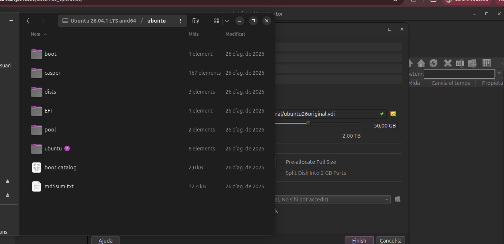

El gestor de màquines virtuals de VirtualBox mostra totes les màquines ja
creades a l'ordinador (Windows, Kali, altres proves d'Ubuntu) mentre es
defineix on es desarà el nou disc virtual.

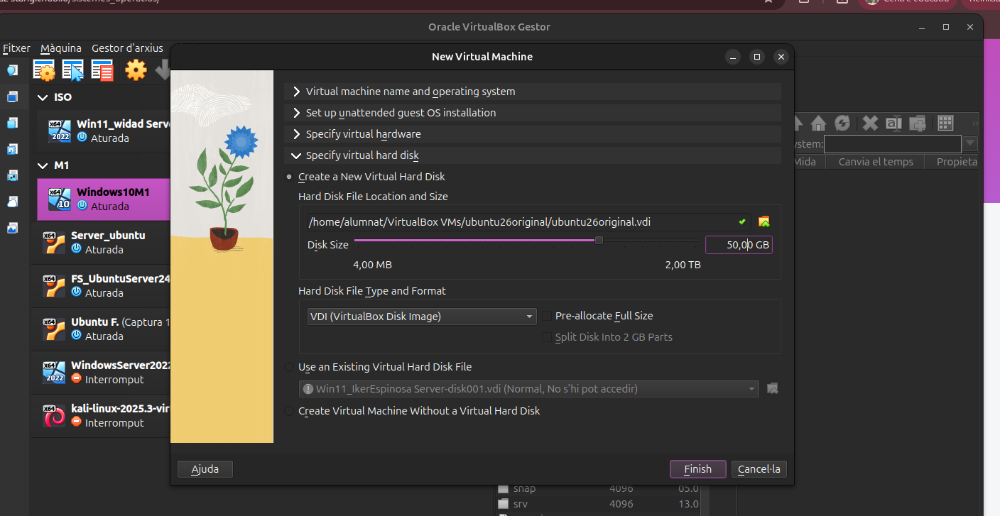

### 2. Maquinari assignat i identificació de la ISO

Es reserven **6064 MB de RAM** i **4 CPU** per a la màquina virtual: prou
recursos perquè Ubuntu funcioni amb fluïdesa sense deixar l'ordinador
amfitrió sense memòria.

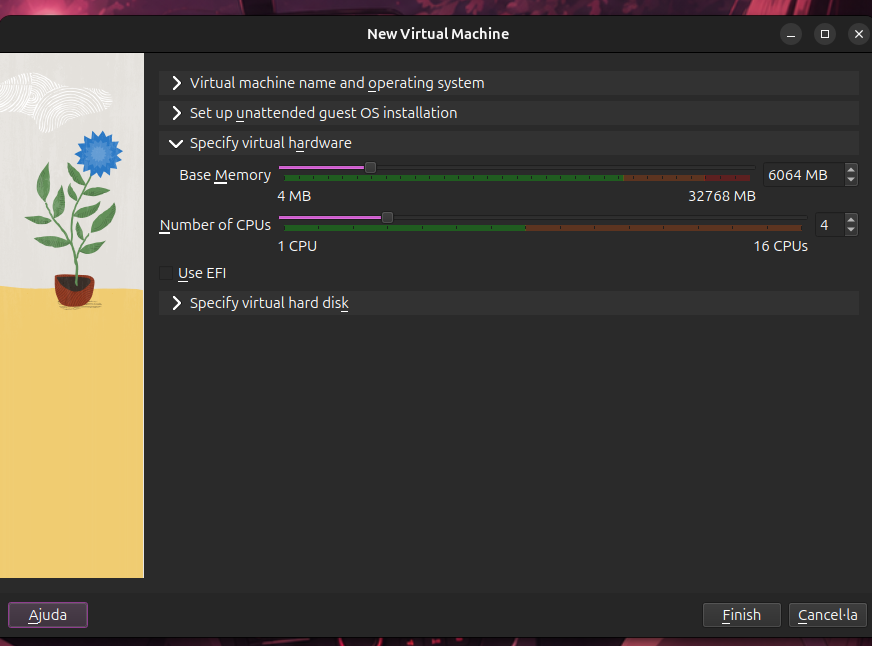

VirtualBox detecta automàticament, a partir de la imatge ISO seleccionada,
que es tracta d'Ubuntu i proposa el tipus de sistema operatiu
corresponent.

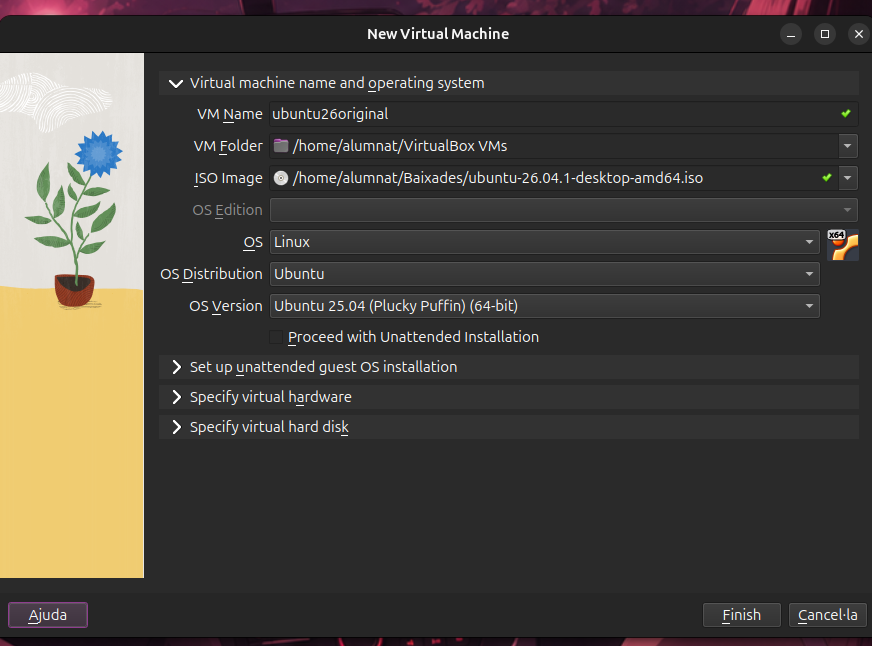

### 3. Primeres passes de l'instal·lador d'Ubuntu

Un cop arrencada la màquina virtual amb la ISO, s'inicia l'assistent
gràfic d'instal·lació d'Ubuntu. El primer pas és triar l'idioma:

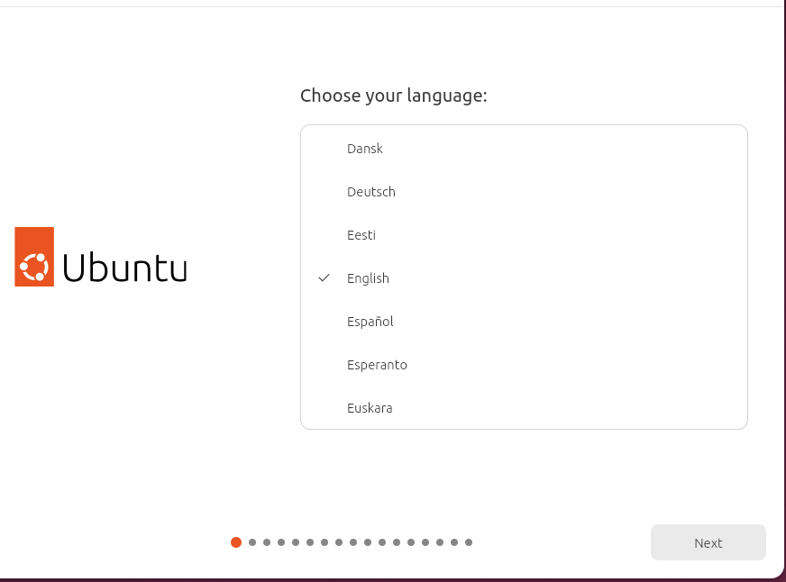

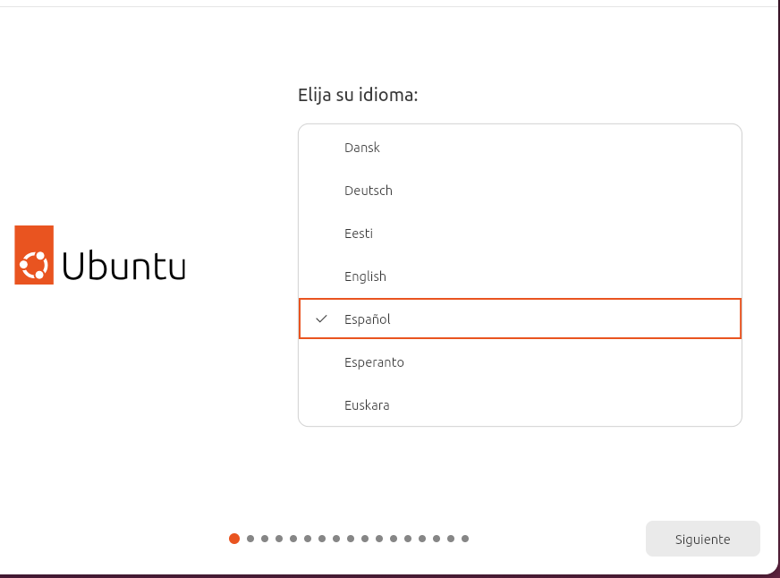

A continuació es tria la disposició del teclat:

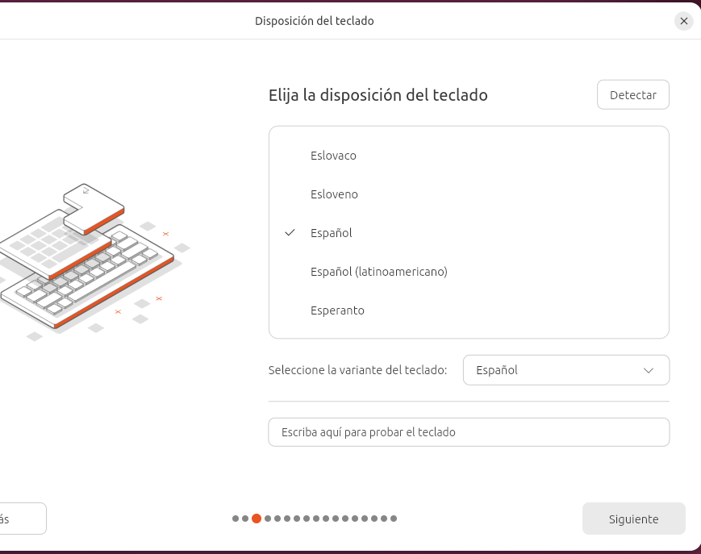

I es configura la connexió a Internet, en aquest cas per cable:

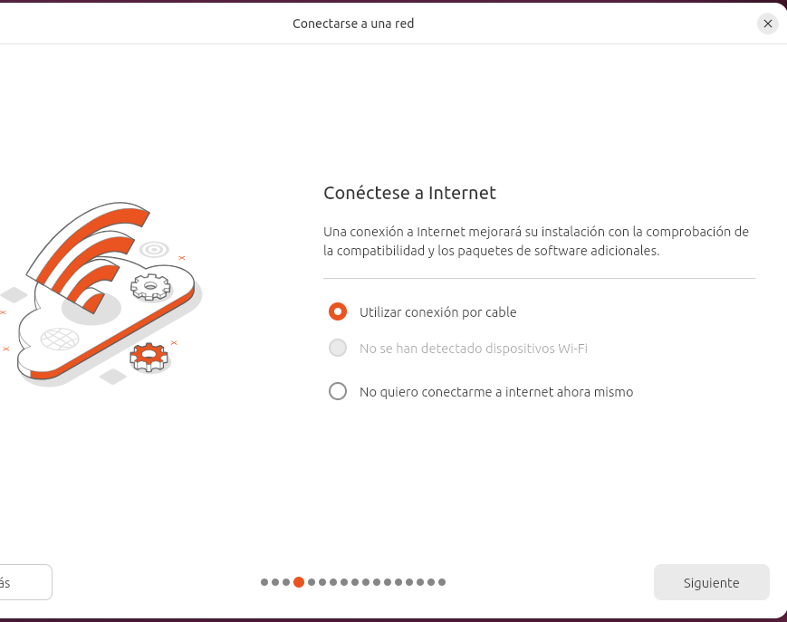

### 4. Tipus d'instal·lació i selecció d'aplicacions

L'instal·lador pregunta si es vol **instal·lar Ubuntu** o només
**provar-lo** sense fer canvis; en aquest cas es tria instal·lar-lo:

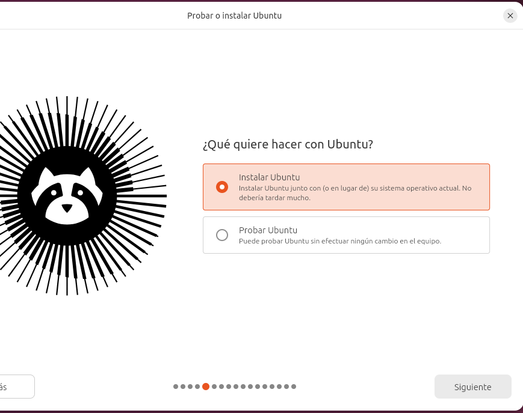

Es tria la instal·lació **interactiva** (pas a pas), en lloc d'una
instal·lació automatitzada amb un arxiu de configuració:

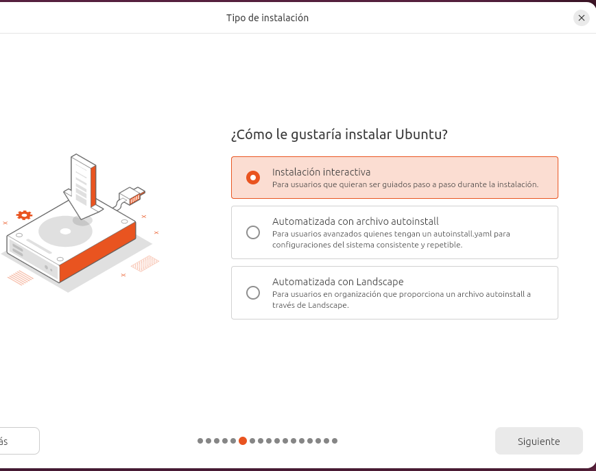

I es deixa la **selecció predeterminada** d'aplicacions (només el
navegador i les utilitats bàsiques):

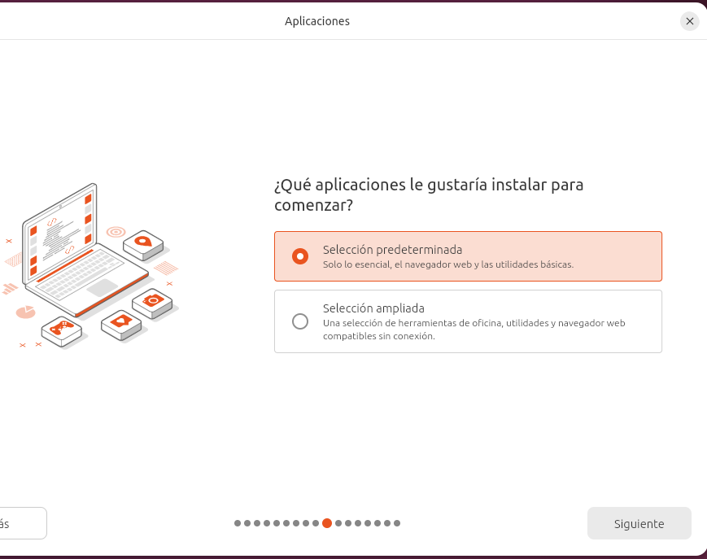

### 5. Configuració del disc i particionament manual

En comptes de deixar que l'instal·lador esborri el disc automàticament,
es tria la **instal·lació manual** per poder definir les particions a
mida:

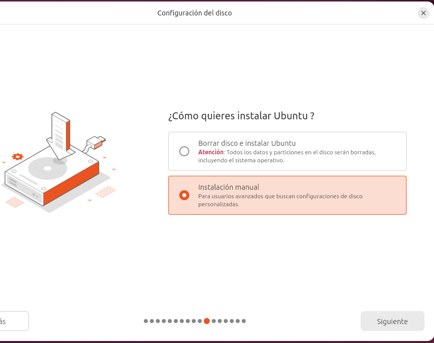

Es crea manualment cada partició indicant la mida, el sistema de fitxers
i el punt de muntatge; en aquest exemple, una partició de 30 GB en
format Ext4 muntada a `/home`:

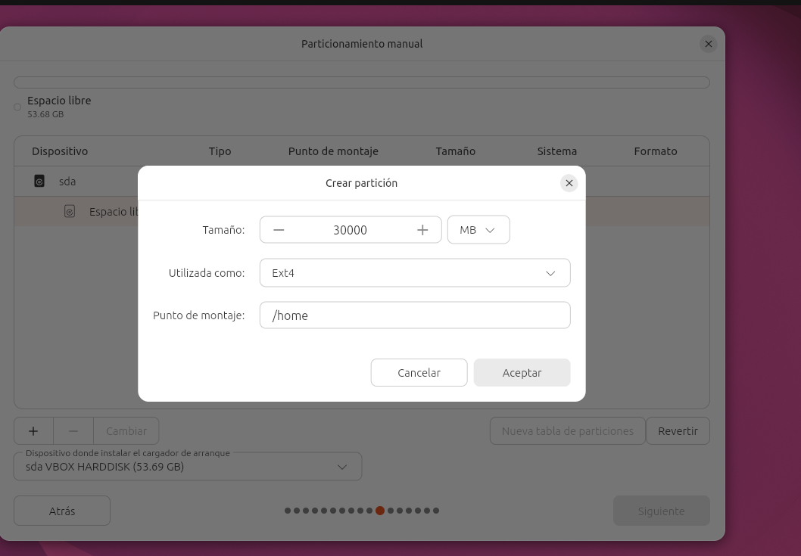

El resultat final és un disc amb tres particions: `/home` (30 GB), `/boot`
(500 MB) i `/` (23,18 GB), totes en Ext4:

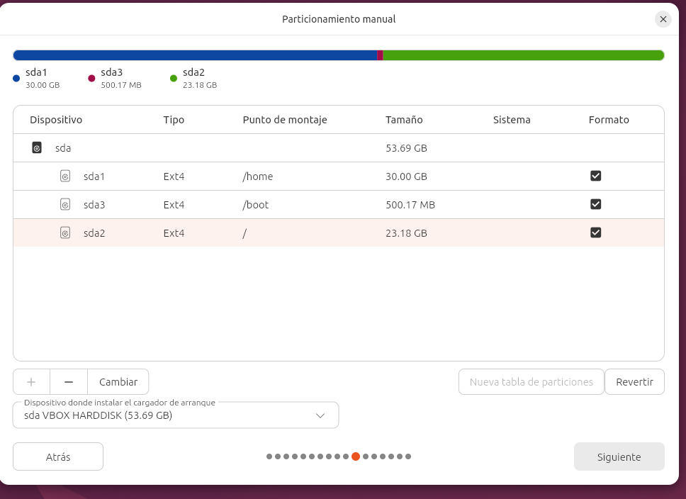

### 6. Creació del compte d'usuari i resum final

Es crea el compte de l'usuari que administrarà el sistema, amb el seu
nom, el nom de l'equip i una contrasenya:

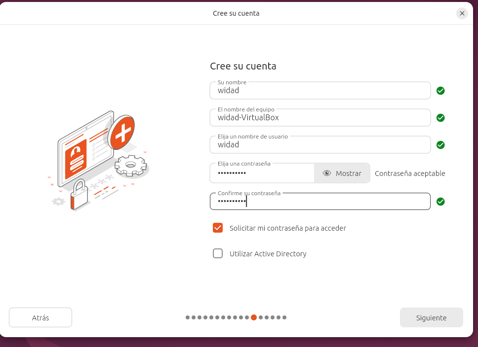

Finalment, l'instal·lador mostra un resum de totes les opcions triades
(instal·lació manual, disc VBOX HARDDISK, sense xifratge, i les tres
particions creades) abans de prémer el botó d'**instal·lar**:

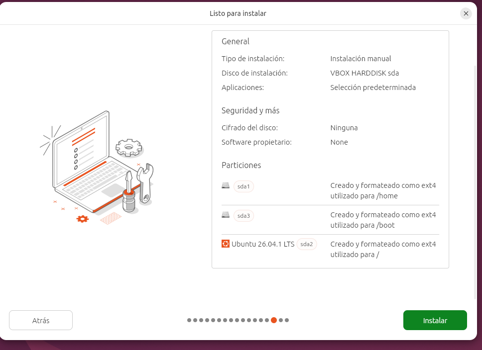

Un cop confirmat, l'instal·lador copia els arxius del sistema al disc
virtual i, en reiniciar la màquina, ja arrenca Ubuntu instal·lat.

## Configuració de xarxa bàsica

La configuració de xarxa és **imprescindible** per poder actualitzar
el sistema i instal·lar programari nou.

- Comprovar l'adreça IP assignada amb `ip a`.
  

- Configurar una IP estàtica si el servei ho requereix.
- Verificar la connectivitat amb `ping`.

*(Apartat pendent d'ampliar amb la pràctica real i captures.)*

## Creació d'usuaris i grups

Cada usuari nou s'hauria d'assignar al **grup mínim necessari** segons
les tasques que ha de fer.

- Crear l'usuari amb `useradd`.
- Assignar contrasenya amb `passwd`.
- Afegir l'usuari als grups necessaris amb `usermod -aG`.


## Gestió de paquets

Un cop instal·lat el sistema, cal saber instal·lar, actualitzar i
eliminar programari. A Ubuntu hi ha diverses eines per fer-ho, de més
a menys automàtiques.

### apt / apt-get

`apt` és el *frontend* modern del gestor de paquets `dpkg` (amb
millores respecte `apt-get`, l'eina més antiga).

**`apt update`** — Actualitza la llista de paquets disponibles,
mirant les adreces dels repositoris definides a
`/etc/apt/sources.list`. No instal·la ni actualitza res per si sol;
cal executar-lo sempre abans d'instal·lar o actualitzar, perquè el
sistema sàpiga quines versions existeixen.


**`apt upgrade`** — Actualitza els paquets que ja tens instal·lats a
la seva darrera versió disponible, però **no instal·la paquets
nous**. És la manera segura de mantenir el sistema al dia sense
sorpreses.


**`apt install paquet`** — Instal·la un paquet nou (per exemple,
`apt install cowsay`), descarregant-lo i instal·lant automàticament
totes les seves dependències.


**`apt remove paquet`** — Desinstal·la un paquet, però deixa els seus
arxius de configuració al sistema per si el tornes a instal·lar més
endavant.

**`apt autoremove`** — Esborra els paquets que es van instal·lar
automàticament com a dependència d'un altre paquet i que ara ja no fa
servir ningú; és bo executar-lo de tant en tant per netejar el
sistema.


### aptitude

Alternativa a `apt` (també té interfície gràfica a més de comandes).
La seva diferència principal és que **recorda les dependències** que
va instal·lar per a cada paquet: si després el desinstal·les, esborra
també aquestes dependències, sempre que cap altre paquet les faci
servir. Aqui em diu que ja tinc instal·lada


**`aptitude install paquet`** — Instal·la un paquet nou, igual que
`apt install`, però recordant quines dependències s'han instal·lat
només per culpa d'aquest paquet.


**`aptitude remove paquet`** — Desinstal·la el paquet i, si cap altre
en depèn, també les dependències que va instal·lar automàticament.


**`aptitude purge paquet`** — Fa el mateix que `remove`, però esborra
també tots els arxius de configuració del paquet.


**`aptitude show paquet`** — Mostra la informació d'un paquet
(versió, descripció, dependències...); si el paquet no està
instal·lat, t'ho indica igualment.


Eina de més baix nivell que `apt`: treballa directament amb arxius
`.deb` ja descarregats i **no resol dependències** per tu (si en
falta alguna, dóna error i cal instal·lar-la a mà amb `apt`).

**`dpkg -i arxiu.deb`** — Instal·la un paquet a partir d'un arxiu
`.deb` que ja tens al disc (per exemple, descarregat manualment des
d'una pàgina web).


**`dpkg -r paquet`** — Desinstal·la el paquet, deixant-ne la
configuració al sistema.


**`dpkg -P paquet`** — Purga el paquet: el desinstal·la i esborra
també tota la seva configuració.

**`dpkg -s paquet`** — Mostra l'estat i la prioritat del paquet
(`required`, `important`, `standard`, `optional` o `extra`), útil per
comprovar si un paquet concret està instal·lat.


**`dpkg --get-selections | grep paquet`** — Filtra la llista de tots
els paquets coneguts pel sistema per buscar-ne un en concret; si no
apareix cap resultat, és que no està instal·lat.


**Pràctica amb el paquet `sl`**

Per provar `dpkg` vaig fer servir el paquet `sl`, un programa petit
que dibuixa un tren al terminal.

1. Primer vaig descarregar l'arxiu `.deb` sense instal·lar-lo amb
   `apt download sl`. Després vaig comprovar amb `ls *.deb` que
   l'arxiu era a la meva carpeta personal i el vaig instal·lar amb
   `sudo dpkg -i sl_*.deb`:

  

3. Amb el paquet instal·lat, en escriure `sl` em va aparèixer el tren
   passant pel terminal. Així vaig veure que la instal·lació havia
   funcionat:

   <video controls muted preload="metadata" src="videos/03-sl-executant.webm"></video>

## Gestor d'arrencada (GRUB2)

El **gestor d'arrencada** és el programa que permet que l'ordinador
engegui el sistema operatiu. El més utilitzat a Ubuntu és **GRUB2**,
que deixa triar entre diferents sistemes si n'hi ha més d'un
instal·lat. Per organitzar l'espai del disc dur hi ha dues opcions:
**MBR** (antic, només funciona amb discos de fins a 2 TB) i **GPT**
(més modern, admet discos més grans i és més segur). Si en arrencar
apareix l'error *grub rescue*, vol dir que el sistema no sap com
arrencar, i es pot solucionar reinstal·lant el gestor amb un USB o una
imatge ISO.

En aquesta pràctica vaig trencar el GRUB expressament i després el vaig
reparar de dues maneres diferents: amb **Super Grub2 Disk** i amb
**Boot-Repair**. Ho vaig fer a la meva màquina virtual
`ubuntu26original`, perquè així no posava en perill l'ordinador real.

### Mètode 1 · Súper Grub2 Disk

1. Primer vaig entrar com a administrador i vaig anar a la carpeta
   `/boot`. Amb `ls` vaig veure que hi havia la carpeta `grub` (en
   blau), al costat dels nuclis de Linux (`vmlinuz-7.0.0-...`) i dels
   fitxers `initrd`:
   ```
   sudo su
   cd /boot
   ls
   ```

   

2. Després vaig esborrar la carpeta `grub/`, que és on hi ha el gestor
   d'arrencada:
   ```
   rm -r grub/
   ```

   

   Vaig tornar a fer `ls` i vaig comprovar que la carpeta `grub` ja no
   hi era. Els nuclis i els `initrd` seguien allà; només faltava el
   programa que els carrega:

   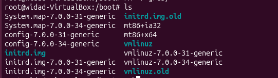

3. Quan vaig reiniciar la màquina, em va sortir l'error
   `file '/boot/grub/i386-pc/normal.mod' not found` i el sistema es va
   quedar en **mode rescat** (`grub rescue>`), sense poder arrencar
   Ubuntu:

   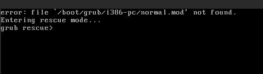

4. Vaig apagar la màquina virtual, vaig anar a **Configuració →
   Emmagatzematge** i vaig posar la imatge ISO de **Super Grub2 Disk**
   (`super_grub2_disk_hybrid_2.02s3.iso`) al lector de CD:

   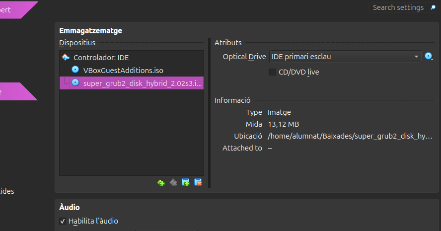

   Un problema que vaig tenir és que la màquina no arrencava des de la
   ISO i tornava a sortir el `grub rescue`. Vaig descobrir que la
   BIOS de VirtualBox només arrenca del CD que està al controlador
   **IDE**, i allà hi tenia la ISO de les *Guest Additions*. Per això
   la ISO s'ha de posar al controlador IDE.

5. Quan va arrencar Super Grub2, vaig triar l'opció **"Detect and show
   boot methods"**. Després vaig seleccionar el nucli de Linux que
   sortia a la llista (`/vmlinuz-7.0.0-...-generic`) i vaig prémer
   **Enter**. Així vaig poder entrar a Ubuntu de forma temporal.

6. Ja dins d'Ubuntu, vaig obrir un terminal, em vaig fer superusuari i
   vaig reinstal·lar el GRUB:
   ```
   sudo su
   grub-install /dev/sda
   
   

   update-grub2
   
   

   apt-get install grub2
   
   ``
`
   - Amb `grub-install /dev/sda` vaig tornar a instal·lar el gestor
     d'arrencada al disc principal, i això va tornar a crear la
     carpeta `/boot/grub`.
   - Amb `update-grub2` vaig generar el menú d'arrencada
     (`grub.cfg`), que busca els nuclis que hi ha instal·lats.
   - Amb `apt-get install grub2` em vaig assegurar que el paquet de
     GRUB estava ben instal·lat.

7. Finalment vaig apagar la màquina, vaig treure la ISO i la vaig
   tornar a engegar. Ubuntu va arrencar normal, amb el GRUB reparat.

### Mètode 2 · Boot-Repair

1. Per provar el segon mètode vaig tornar a trencar el GRUB de la
   mateixa manera:
   ```
   cd /boot
   sudo rm -r grub/
   ```
   En reiniciar em va tornar a sortir el `grub rescue`:

   

2. Vaig apagar la màquina virtual i aquesta vegada vaig posar la ISO
   de **Boot-Repair** (`boot-repair-disk-64bit.iso`) al lector de CD
   del controlador IDE, en lloc de la de Super Grub2.

3. En engegar la màquina, Boot-Repair-Disk va carregar un escriptori
   *live* i es va obrir sol el programa **Boot Repair**. Vaig triar
   **"Recommended repair"** (la reparació recomanada):

   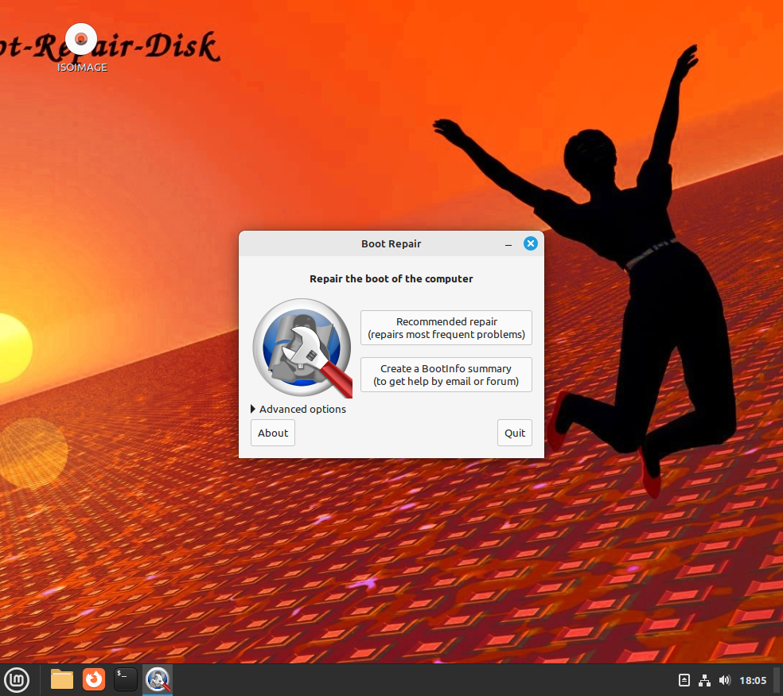

4. Durant la reparació em va preguntar si volia pujar l'informe a
   internet (*"Upload the report to a pastebin?"*). Vaig dir que
   **No**, perquè no feia falta: l'informe es guarda igualment a
   `/var/log/boot-repair/`.

   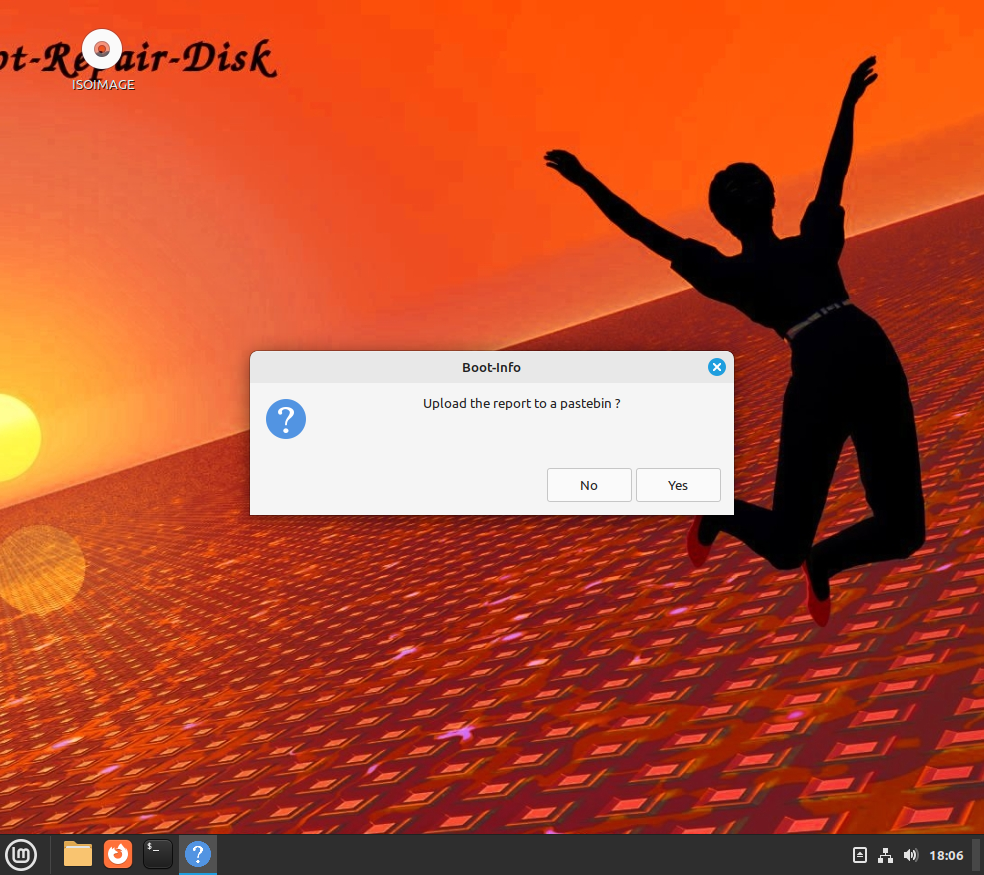

5. Quan va acabar, em va sortir el missatge **"Boot successfully
   repaired"**, que vol dir que el GRUB s'havia reparat bé:

   

6. Vaig apagar la màquina, vaig treure la ISO de Boot-Repair i la vaig
   tornar a engegar. Aquesta vegada ja no es va quedar al `grub
   rescue`: Ubuntu va arrencar normal i em va sortir la pantalla per
   iniciar sessió:

   

**Diferència entre els dos mètodes**: amb Super Grub2 Disk vaig haver
d'arrencar Ubuntu de forma temporal i després reinstal·lar el GRUB jo
amb comandaments (`grub-install`, `update-grub2`). En canvi,
amb Boot-Repair tot es va fer automàticament i només vaig haver de
prémer un botó. Per a mi, Boot-Repair és més fàcil, però amb Super
Grub2 entens millor què està passant.

## Comprovació final

Abans de donar per acabat el sprint, revisa aquest resum:

- El sistema arrenca sense errors i GRUB mostra el menú d'arrencada.
- La xarxa respon correctament als _pings_.
- **Els usuaris i grups creats coincideixen amb l'enunciat.**
