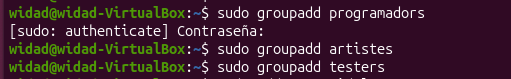
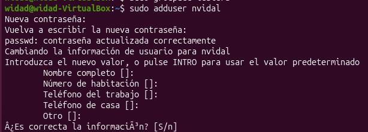
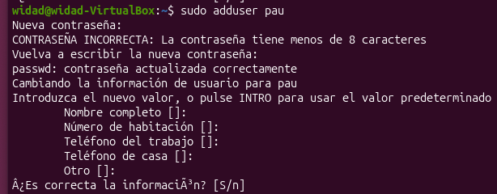
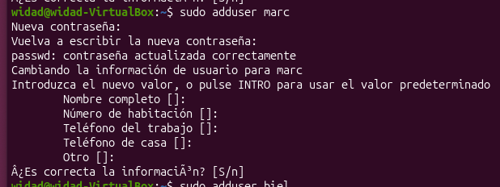
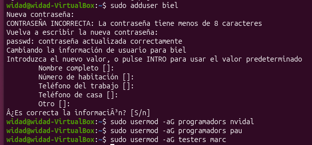

## Particions i sistemes de fitxers

Un disc nou no es pot fer servir directament: primer es **parteix** (es crea la taula
de particions), després es **formata** cada partició (se li posa un sistema de
fitxers) i finalment es **munta** en una carpeta de l'arbre de Linux.

### Conceptes bàsics

- **Disc**: el dispositiu sencer, físic o virtual (`/dev/sda`, `/dev/sdb`...).
- **Taula de particions**: l'índex al principi del disc que diu on comença i on
  acaba cada partició (MBR o GPT).
- **Partició**: un tros continu del disc que el sistema tracta com un disc
  independent (`/dev/sdb1`).
- **Sistema de fitxers**: l'estructura que es posa a la partició en formatar-la
  perquè s'hi puguin guardar fitxers i carpetes (ext4, NTFS, FAT32...).
- **Sector**: la unitat física més petita que el disc pot llegir o escriure (512
  bytes tradicionalment, 4096 bytes als discos moderns).
- **Bloc**: la unitat amb què treballa el sistema de fitxers, un grup de sectors
  consecutius (normalment 4096 bytes a ext4). Un fitxer sempre ocupa blocs sencers,
  encara que no els ompli del tot — l'espai que es perd es diu **fragmentació
  interna**.
- **Punt de muntatge**: la carpeta de l'arbre de Linux on s'entra al contingut
  d'una partició (`/var/particio1`). A Linux no hi ha lletres com `C:` o `D:`.

### L'exercici del disc del servidor de l'acadèmia

Encara em falta fer l'exercici d'afegir un disc nou de 3 GB a la màquina
virtual, amb una taula GPT de quatre particions (una per a projectes grans,
una per a molts fitxers petits, una per intercanviar fitxers amb Windows i
una d'intercanvi de memòria), muntar-ho tot de forma permanent amb
`/etc/fstab`, i fer l'experiment de fragmentació interna comparant l'espai
que ocupen els mateixos fitxers amb mides de bloc diferents.

## Recuperació de fitxers després d'un formateig

Pràctica independent per comprovar que formatar un disc no esborra els fitxers
de seguida: només esborra l'índex que diu on és cadascun.

### Preparació: tres fitxers de prova

Vaig crear la carpeta `~/practica` i hi vaig posar tres fitxers: una foto i un PDF
copiats amb l'aplicació Fitxers, i un text creat directament des del terminal amb
`echo`:
```
echo "El meu secret és que m'encanta la pizza amb pinya" > notes.txt
```


Després en vaig calcular el hash amb `sha256sum`, per poder comprovar més endavant
que els fitxers recuperats són exactament els mateixos:
```
sha256sum foto.jpg apunts.pdf notes.txt > originals.sha
cat originals.sha
```


### Creació del disc virtual

Vaig crear un fitxer de 200 MB ple de zeros, que fa de disc durant tota la
pràctica:
```
dd if=/dev/zero of=disc.img bs=1M count=200 status=progress
ls -lh disc.img
```


### Formatar, muntar i copiar-hi els fitxers

Vaig formatar el disc virtual amb ext4:
```
mkfs.ext4 disc.img
```


Després el vaig muntar i hi vaig copiar els tres fitxers:
```
sudo mkdir -p /mnt/prova
sudo mount -o loop disc.img /mnt/prova
sudo cp foto.jpg apunts.pdf notes.txt /mnt/prova/
ls -l /mnt/prova
```


### Formateig d'alt nivell

Vaig desmuntar el disc i el vaig tornar a formatar (com si volgués reutilitzar un
USB), confirmant l'avís perquè ja tenia un sistema de fitxers:
```
sudo umount /mnt/prova
mkfs.ext4 -E nodiscard disc.img
```
Després vaig muntar-lo de nou per veure què hi quedava:
```
sudo mount -o loop disc.img /mnt/prova
ls -l /mnt/prova
sudo umount /mnt/prova
```


Els fitxers han desaparegut de l'índex i el disc sembla buit, però encara hi
són físicament — això ho vaig comprovar al pas següent amb `photorec`.

### Recuperació amb photorec

Vaig executar `photorec` sobre el disc, sense necessitar l'índex que s'havia
esborrat:
```
photorec /d recup /cmd disc.img options,fileopt,everything,enable,search
```


Com que vaig activar la recuperació de **tots** els tipus de fitxer
(`everything`), `photorec` també va interpretar com a vàlids molts blocs buits
del disc (zeros) com si fossin capçaleres d'un format de correu (`.dovecot`),
cosa que va generar milers de falsos positius. A més, `photorec` crea una
carpeta nova cada cert nombre de fitxers trobats, així que en comptes d'una sola
carpeta `recup.1` en van sortir sis:
```
ls -d recup.*
```


Encara em falta localitzar la foto i el PDF reals entre tots els falsos
positius i comprovar amb `sha256sum` que són idèntics als originals, buscar
el text de `notes.txt` directament dins del disc amb `strings | grep` (ja
que `photorec` no reconeix fitxers de text sense capçalera), i finalment
omplir tot el disc de zeros per comprovar que, aquesta vegada, ni `photorec`
ni la cerca de text troben res.

## Gestió de processos

Missió «El servidor va lent»: com a administrador d'un servidor Ubuntu, cal
trobar quins processos sospitosos hi ha, investigar-los amb `ps`, passar la
descàrrega legítima a segon pla, donar-li prioritat i neutralitzar els intrusos.

Conceptes clau: un **procés** és un programa mentre s'executa, amb un **PID**
(identificador únic) i un **PPID** (el PID del seu procés pare); si el pare
acaba abans, el procés queda orfe i l'adopta `systemd`. Un procés en **primer
pla** ocupa el terminal; en **segon pla** (`&`) el deixa lliure. Els **senyals**
(`SIGTERM`, `SIGKILL`, `SIGSTOP`, `SIGCONT`...) serveixen per demanar-li a un
procés que acabi, que es pari o que continuï. La **prioritat** (`nice`/`renice`)
decideix quant de CPU rep un procés quan n'hi ha diversos competint.

Vaig crear la carpeta `~/missio` i els cinc scripts del sabotatge (`minador`,
`espia`, `backup_nocturn`, `descarrega.sh` i `sospitosos.sh`), però encara em
falta fer i documentar tota la resta de la missió (reconeixement amb `ps` i
`pstree`, trobar qui consumeix més amb `top`, filtrar amb `grep`/`pgrep`,
moure la descàrrega entre primer i segon pla, pujar-li la prioritat, i
neutralitzar els intrusos amb els senyals adequats).

## Gestió de permisos

Missió «PixelForge» (3a part): a l'estudi de videojocs tothom pot llegir i
esborrar els fitxers de tothom, i el codi del joc ha quedat obert a tot
l'estudi. M'ha tocat posar-hi ordre: donar a cada equip la seva carpeta, fer
que els fitxers nous surtin del grup correcte, protegir una carpeta
compartida i donar accés puntual a algú de fora de l'equip.

Cada fitxer té tres permisos (`r` llegir, `w` escriure, `x`
executar/entrar-hi) per a tres destinataris: propietari (`u`), grup (`g`) i
resta (`o`). Es poden escriure en lletres (`-rwxr-xr--`) o en número, sumant
`r`=4, `w`=2, `x`=1 per cada grup de tres; així `chmod 750` és propietari
`rwx`, grup `r-x`, resta sense res. A més hi ha tres permisos especials: el
**SUID** fa que un programa s'executi amb la identitat del seu propietari;
el **SGID** fa que els fitxers nous d'una carpeta heretin el grup de la
carpeta; i el **sticky bit** deixa que tothom creï fitxers en una carpeta
compartida però que cadascú només pugui esborrar els seus (com a `/tmp`).

Vaig començar creant els usuaris i grups que em feien falta, perquè encara
no els tenia de cap pràctica anterior:
```
sudo groupadd programadors
sudo groupadd artistes
sudo groupadd testers
sudo adduser nvidal
sudo adduser pau
sudo adduser marc
sudo adduser biel
sudo usermod -aG programadors nvidal
sudo usermod -aG programadors pau
sudo usermod -aG testers marc
```







**Nivell 0.** Vaig muntar l'estudi: una carpeta per `/srv/pixelforge` amb
una subcarpeta per equip (`codi`, `art`, `proves`) i una de compartida, amb
un fitxer d'exemple a cada una:
```
sudo mkdir -p /srv/pixelforge
cd /srv/pixelforge
sudo mkdir codi art proves compartit
sudo touch codi/joc.py art/logo.png proves/informe.txt
ls -l /srv/pixelforge
```


Tot surt de `root root` perquè ho he creat amb `sudo`; en els nivells
següents ho vaig donant a cada equip.

**Nivell 1.** Abans de canviar res, vaig practicar llegint permisos: els del
fitxer `joc.py` (`644`, el propietari llegeix i escriu, la resta només
llegeix), els de la carpeta `codi` mateixa amb `-d` (`755`, tothom hi entra
però només `root` hi crea fitxers), i els mateixos amb `stat`, que els dona
en lletres i en número alhora:
```
ls -l /srv/pixelforge/codi/joc.py
ls -ld /srv/pixelforge/codi
stat /srv/pixelforge/codi/joc.py
```


Pel repte 1 vaig mirar dos fitxers crítics del sistema. `/etc/shadow` és
`640` del grup `shadow`: només `root` i els programes d'aquell grup (com
`passwd`) el poden llegir. `/root` és `700`: ni tan sols el grup hi té cap
permís, només el propietari.
```
ls -l /etc/shadow
ls -ld /root
```


**Nivell 2.** Amb números, vaig posar `750` a `codi` (amb `-R`, perquè
s'apliqui també al fitxer de dins), `755` a `art` i `640` al fitxer privat
`proves/informe.txt`:
```
sudo chmod -R 750 /srv/pixelforge/codi
ls -ld /srv/pixelforge/codi
ls -l /srv/pixelforge/codi
sudo chmod 755 /srv/pixelforge/art
sudo chmod 640 /srv/pixelforge/proves/informe.txt
ls -l /srv/pixelforge/proves
```


**Nivell 3.** Amb lletres, en canvi, es poden tocar permisos un a un sense
recalcular tot el número. A `art` vaig treure la `w` del propietari
(`u-w`), i després vaig deixar la resta sense cap permís (`o=`):
```
sudo chmod u-w /srv/pixelforge/art
ls -ld /srv/pixelforge/art
sudo chmod u+w /srv/pixelforge/art
sudo chmod o= /srv/pixelforge/art
ls -ld /srv/pixelforge/art
sudo chmod g+rx,o-w /srv/pixelforge/art
```


**Nivell 4.** Vaig donar `codi` a en Pau i al grup `programadors`, i vaig
canviar només el grup de `proves` a `testers`:
```
sudo chown -R pau:programadors /srv/pixelforge/codi
ls -l /srv/pixelforge
sudo chgrp -R testers /srv/pixelforge/proves
ls -ld /srv/pixelforge/proves
```


Per comprovar-ho, vaig entrar com a `pau`: va poder crear un fitxer a
`codi` sense problema, però a `proves` li va sortir `Permission denied`.
```
su - pau
cd /srv/pixelforge/codi
touch nivell1.py
ls -l
touch /srv/pixelforge/proves/intrus.txt
exit
```


**Nivell 5.** El problema de l'SGID: amb `codi` ja amb permís d'escriptura
pel grup, quan la Núria (`nvidal`, del grup `programadors`) hi crea un
fitxer, surt del seu grup personal (`nvidal`), no de `programadors`:
```
sudo chmod g+w /srv/pixelforge/codi
ls -ld /srv/pixelforge/codi
su - nvidal
touch /srv/pixelforge/codi/mapa.py
ls -l /srv/pixelforge/codi
exit
```


Posant el bit SGID a la carpeta (la `s` a `drwxrws---`), els fitxers nous ja
surten del grup `programadors` — el fitxer antic `mapa.py` es queda com
estava, perquè l'SGID només afecta el que es crea després:
```
sudo chmod g+s /srv/pixelforge/codi
ls -ld /srv/pixelforge/codi
su - nvidal
touch /srv/pixelforge/codi/so.py
ls -l /srv/pixelforge/codi
exit
```


**Nivell 6.** Vaig preparar `compartit` amb `777` perquè tothom hi pogués
escriure, i vaig comprovar el problema de no tenir sticky bit: en Marc va
poder esborrar un fitxer d'en Pau només confirmant-ho (`rm` el deixa fer,
només pregunta):
```
sudo chmod 777 /srv/pixelforge/compartit
su - pau
touch /srv/pixelforge/compartit/de_pau.txt
exit
su - marc
rm /srv/pixelforge/compartit/de_pau.txt
```


Em falta posar el sticky bit i repetir la prova perquè en Marc ja no pugui
esborrar el fitxer d'en Pau. Després em queden els nivells 7 (ACL per a en
Marc a `codi`, sense posar-lo al grup) i 8 (`umask` i el SUID de
`/usr/bin/passwd`), i els reptes 2 a 8.
