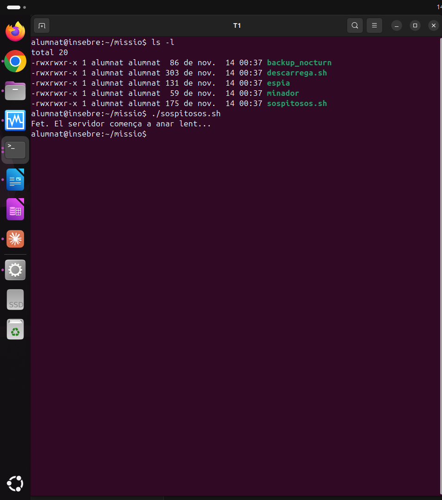
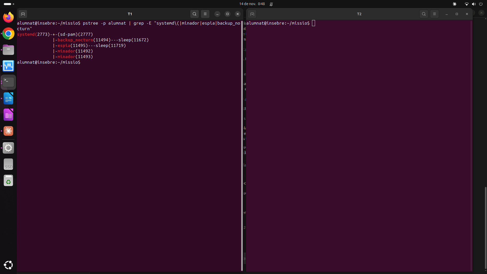
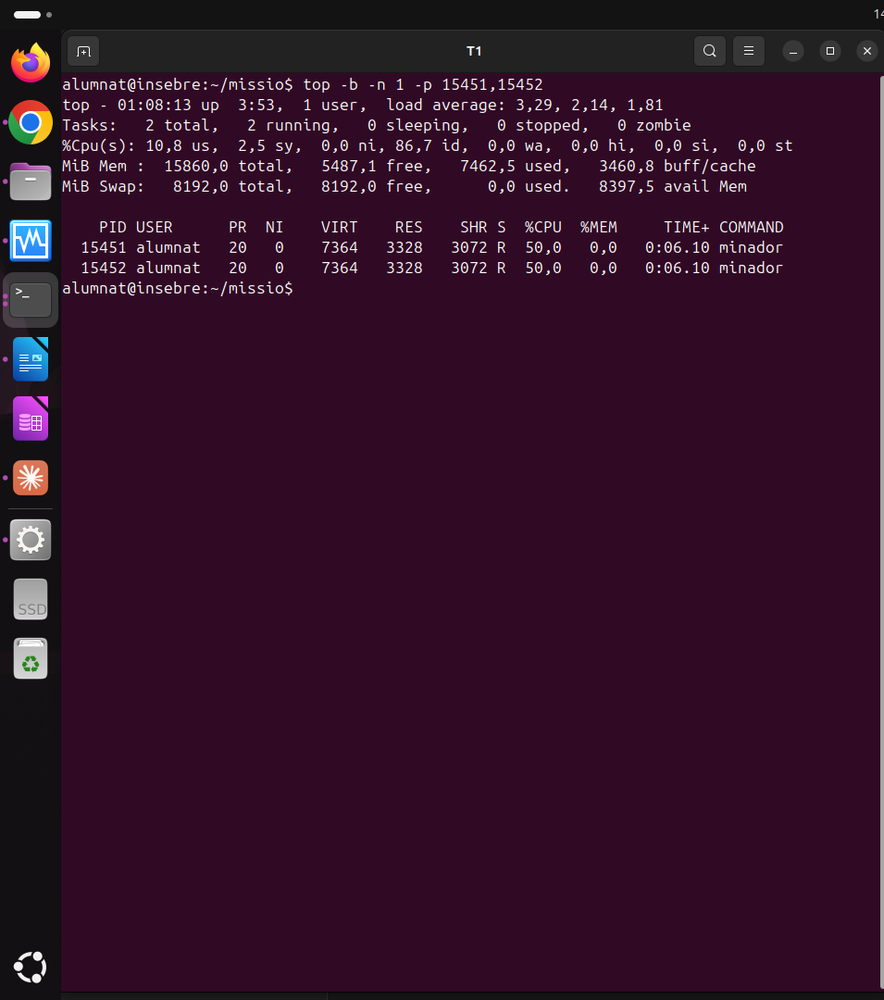
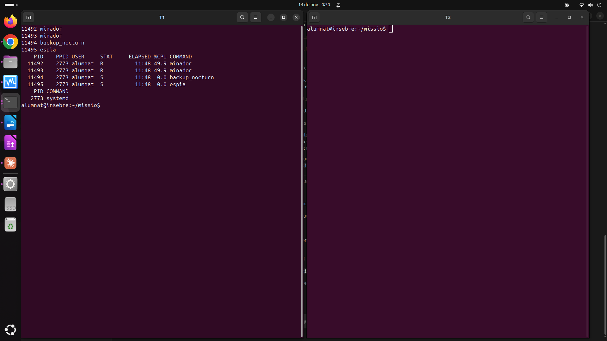
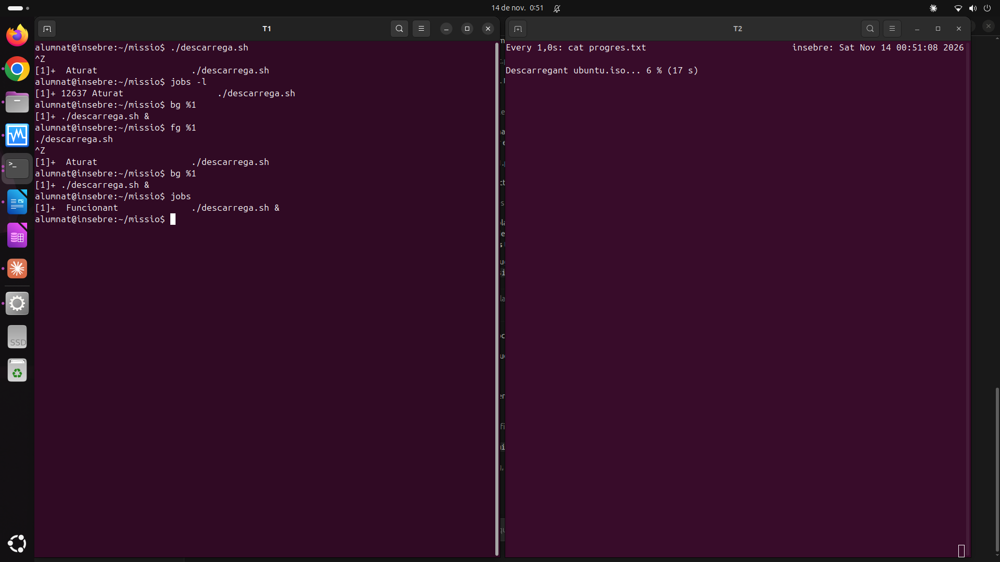
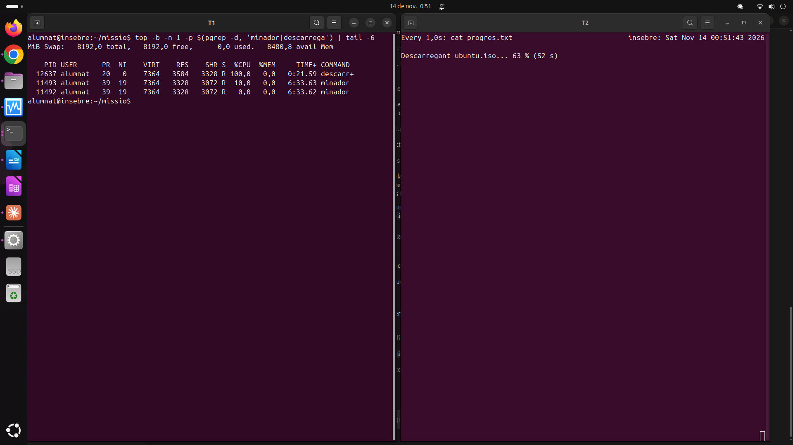
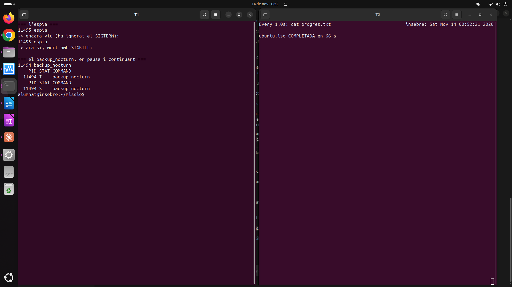
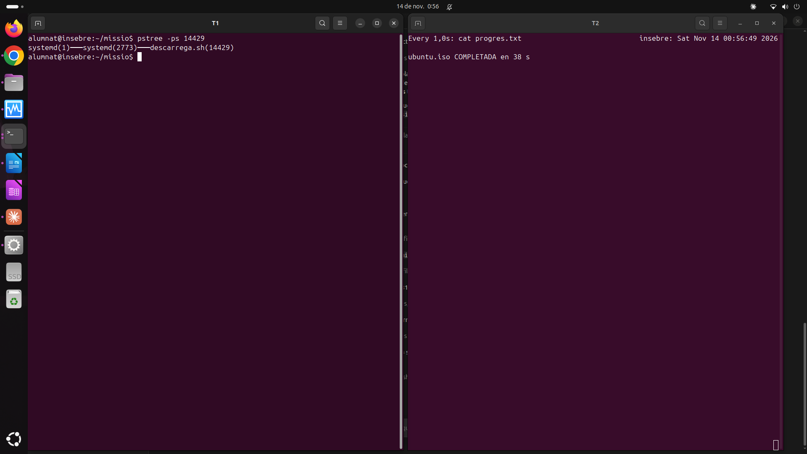

## Teoria · processos, estats i senyals

Un **procés** és un programa mentre s'executa, amb la seva pròpia memòria i
temps de CPU. Cada procés té un **PID** únic i un **PPID** (el PID del seu
pare), de manera que tots els processos formen un arbre que arrenca a
`systemd` (PID 1, o el `systemd --user` de cada usuari). Si el pare d'un
procés acaba abans que ell, el procés queda **orfe** i l'adopta `systemd`.

Un procés pot estar **en execució/preparat** (`R`), **dormint** (`S`),
**esperant el disc sense poder-se interrompre** (`D`), **aturat** (`T`, per
exemple amb `Ctrl+Z`) o **zombi** (`Z`, ja ha acabat però el pare encara no
n'ha recollit el resultat). Un procés en **primer pla** ocupa el terminal;
un procés en **segon pla** (llançat amb `&`) deixa el terminal lliure.

Per comunicar-se amb un procés el sistema fa servir **senyals**: `SIGTERM`
(15, demana que acabi, es pot ignorar), `SIGKILL` (9, el mata sempre, no es
pot ignorar ni capturar), `SIGSTOP`/`SIGCONT` (atura i reprèn) i `SIGHUP`
(s'envia quan es tanca el terminal). La prioritat d'un procés es controla
amb el valor **nice** (de -20, més prioritat, a 19, menys); un usuari normal
només pot pujar el nice dels seus processos, no baixar-lo, tret que sigui
`root`.

## Pràctica · la missió «el servidor va lent»

Vaig fer tota la missió al meu ordinador real (Ubuntu 24.04), amb dos
terminals oberts un al costat de l'altre: **T1** a l'esquerra i **T2** a la
dreta.

### Nivell 0 · preparar el cas

Vaig crear la carpeta `~/missio` i, amb `nano`, els cinc scripts de la
missió: `minador` (gasta CPU sense parar en un bucle infinit),
`backup_nocturn` (simula una còpia que es passa el temps dormint),
`espia` (amb un `trap` que li fa ignorar el `SIGTERM` i escriure un
missatge en lloc d'acabar), `descarrega.sh` (simula una descàrrega que
gasta CPU i va escrivint el progrés a `progres.txt`) i `sospitosos.sh`
(engega els tres intrusos en segon pla). Els vaig donar permís d'execució
amb `chmod +x` i vaig comprovar que sortien en verd i amb una `x` a `ls -l`.

En executar `./sospitosos.sh` es van engegar els dos `minador`, el
`backup_nocturn` i l'`espia`, i el terminal va quedar lliure amb el
missatge *"Fet. El servidor comença a anar lent..."*.

### Nivell 1 · reconeixement, veure els processos

Amb `echo $$` vaig veure el PID de la meva shell, i amb `ps -A | wc -l` vaig
comptar uns quants centenars de processos al sistema. Filtrant l'arbre amb
`pstree -p $USER`, els sospitosos no sortien penjats del meu `bash`: havien
quedat **orfes** i els havia adoptat el `systemd --user` (PID 2773 en el
meu cas), exactament com explica la teoria.

### Nivell 2 · qui consumeix més?

Amb `top` vaig veure els dos `minador` com els processos que més CPU
feien servir, repartint-se-la al 50% cadascun (perquè els vaig engegar amb
`taskset -c 0`, forçats a la mateixa CPU). Filtrant `top` només pels seus
dos PID (`top -b -n 1 -p PID1,PID2`) es veu clarament:

### Nivell 3 · interrogatori, filtrar amb ps

Vaig fer servir `ps aux | grep minador` i vaig veure que la pròpia línia
del `grep` també sortia a la llista; amb el truc `grep [m]inador` aquesta
línia desapareix. Amb `pgrep -l 'minador|espia|backup'` vaig trobar els
PID dels quatre sospitosos alhora, i amb
`ps -o pid,ppid,user,stat,etime,%cpu,comm -C minador,espia,backup_nocturn`
vaig veure que tots quatre tenen el mateix **PPID**. Comprovant qui és
aquest PPID amb `ps -o pid,comm -p` surt `systemd`.

### Nivell 4 · la descàrrega urgent, primer i segon pla

A T2 vaig deixar un `watch -n 1 cat progres.txt` mostrant el progrés. A T1
vaig engegar `./descarrega.sh` en primer pla: el terminal va quedar ocupat
i el percentatge de T2 pujava. Amb `Ctrl+Z` la vaig deixar **aturada**
(`[1]+ Aturat`) i el percentatge es va quedar congelat; amb `jobs -l` vaig
apuntar-ne el PID. Després la vaig fer continuar en segon pla amb `bg %1`
(el percentatge torna a pujar i el terminal queda lliure), la vaig tornar
a primer pla amb `fg %1`, i finalment la vaig deixar definitivament en
segon pla fent `Ctrl+Z` una altra vegada i `bg %1`. `jobs` confirma que
queda **Funcionant**.

### Nivell 5 · prioritat a la descàrrega

Amb `top -p $(pgrep -d, 'minador|descarrega')` vaig veure els tres
processos repartint-se la CPU 0 a parts iguals (~27% cadascun). Vaig
intentar pujar la prioritat de la descàrrega amb `renice -n -10`, però com
a usuari normal em va sortir **"S'ha denegat el permís"**: només `root` pot
pujar la prioritat d'un procés. Com que no volia fer servir `sudo`, vaig
aplicar el **pla B** que dona la mateixa guia: en lloc de pujar la de la
descàrrega, vaig **baixar** la dels dos `minador` amb `renice -n 19 -p`.
El resultat és el mateix: a la següent foto de `top`, la descàrrega passa
a fer servir el 100% de la CPU 0 (els `minador` queden a `NI 19`) i el
percentatge de T2 puja molt més ràpid.

### Nivell 6 · neutralitzar els intrusos

Vaig matar els dos `minador` amb `kill` (SIGTERM) i van desaparèixer a la
primera. Amb l'**espia** no va funcionar: `pgrep -l espia` el seguia
mostrant després del `kill` perquè el seu `trap` li fa ignorar el
`SIGTERM`; només va desaparèixer amb `kill -9` (SIGKILL, que no es pot
ignorar). Al `backup_nocturn`, que és un procés legítim, no el vaig matar:
el vaig posar en pausa amb `kill -STOP` (estat `T`) i el vaig fer continuar
amb `kill -CONT` (torna a l'estat `S`, dormint normal).

### Nivell 7 · que la descàrrega no es perdi

Vaig obrir un terminal nou (sense `screen`, perquè volia que tanqués de
veritat) i hi vaig engegar una descàrrega nova en segon pla, **sense**
`nohup`. En tancar la finestra, el procés va morir a l'instant: el
`SIGHUP` que envia el terminal en tancar-se el va matar perquè no l'estava
ignorant. Vaig repetir-ho, aquesta vegada amb `nohup ./descarrega.sh &`:
en tancar la finestra, la descàrrega **va continuar** (el `nohup` fa que
ignori el `SIGHUP`) i va quedar adoptada per `systemd`, exactament com els
sospitosos del nivell 1. Un `pstree -ps` fet mentre encara corria ho
confirma: `systemd(1)──systemd(2773)──descarrega.sh`. T2 va acabar
mostrant **"ubuntu.iso COMPLETADA en 38 s"** encara que la finestra que
l'havia engegat ja no existia.

### Neteja final

Per acabar vaig matar tots els processos de la missió que encara quedaven
amb `pkill 'minador|espia|backup_nocturn|descarrega'` i vaig comprovar amb
`pgrep` que no en quedava cap, i vaig tancar el `watch` de T2 amb `Ctrl+C`.

## Comprovació final

- Els cinc scripts de `~/missio` tenen permís d'execució i funcionen.
- Sé trobar el PID i el PPID de qualsevol procés i explicar per què els
  sospitosos queden orfes i els adopta `systemd`.
- Distingeixo quan cal `kill` i quan cal `kill -9` (un procés amb `trap`
  pot ignorar el primer, mai el segon).
- Sé moure un procés entre primer pla, segon pla i aturat (`Ctrl+Z`,
  `bg`, `fg`) i entenc per què `nohup` el protegeix de tancar el terminal.
- Sé canviar la prioritat d'un procés amb `nice`/`renice`, i que sense
  `sudo` només puc baixar-la, no pujar-la.
