## Particions i sistemes de fitxers

Un disc nou no es pot fer servir directament: primer es **parteix** (es crea la taula
de particions), després es **formata** cada partició (se li posa un sistema de
fitxers) i finalment es **munta** en una carpeta de l'arbre de Linux.

### Conceptes bàsics

- **Disc**: el dispositiu sencer, físic o virtual (`/dev/sda`, `/dev/sdb`...).
- **Taula de particions**: l'índex al principi del disc que diu on comença i on
  acaba cada partició (MBR o GPT).
- **Partició**: un tros continu del disc que el sistema tracta com un disc
  independent (`/dev/sdb1`).
- **Sistema de fitxers**: l'estructura que es posa a la partició en formatar-la
  perquè s'hi puguin guardar fitxers i carpetes (ext4, NTFS, FAT32...).
- **Sector**: la unitat física més petita que el disc pot llegir o escriure (512
  bytes tradicionalment, 4096 bytes als discos moderns).
- **Bloc**: la unitat amb què treballa el sistema de fitxers, un grup de sectors
  consecutius (normalment 4096 bytes a ext4). Un fitxer sempre ocupa blocs sencers,
  encara que no els ompli del tot — l'espai que es perd es diu **fragmentació
  interna**.
- **Punt de muntatge**: la carpeta de l'arbre de Linux on s'entra al contingut
  d'una partició (`/var/particio1`). A Linux no hi ha lletres com `C:` o `D:`.

### L'exercici del disc del servidor de l'acadèmia

A classe hem fet primer la demostració de la fragmentació interna amb un
fitxer de prova. He creat `prova.txt` amb només 5 bytes i he mirat la seva
mida amb diferents ordres:

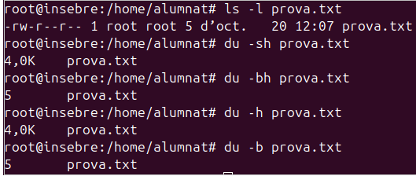

Amb `ls -l` i `du -b`/`du -bh` es veu la mida real del fitxer (5 bytes),
però amb `du -h`/`du -sh` surt 4,0K: el sistema de fitxers no reserva mai
menys d'un bloc sencer per a un fitxer, encara que només hi càpiguen 5
bytes. Ho he confirmat mirant la mida de bloc del disc:

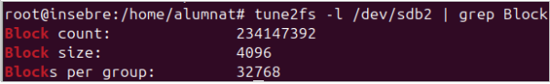

`tune2fs -l /dev/sdb2 | grep Block` diu que la mida de bloc és de 4096
bytes, que són exactament els 4,0K que es veien amb `du -h`. Aquí és on es
nota la fragmentació interna: els 4091 bytes que sobren dins d'aquell bloc
es perden, no es poden fer servir per a cap altre fitxer.

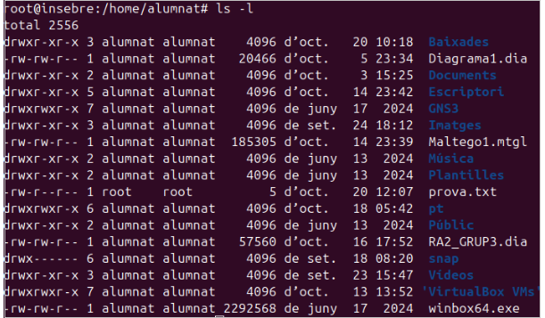

Una cosa que m'ha confós és que `prova.txt` surt com a propietat de `root`
(l'he creat amb `sudo`) però es troba dins de la carpeta de l'usuari
`alumnat`, no dins de `/root`:

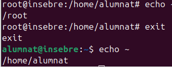

Amb `echo ~` es veu que el `HOME` de `root` és `/root` i el de `alumnat` és
`/home/alumnat`, però `sudo` només canvia qui és el propietari del fitxer
que es crea, no la carpeta on es crea: el fitxer apareix allà on estava
situat el terminal en aquell moment, no al `HOME` de `root`.

### L'exercici del disc de 3 GB

Vaig afegir un disc nou al controlador SATA de la màquina virtual. La
primera vegada el vaig crear amb una mida equivocada (4 MB en comptes de
3 GB) i, a sobre, com a mida fixa, que no es pot redimensionar; el vaig
haver d'eliminar i tornar a crear bé, com a **assignat dinàmicament** i
amb 3072 MB:
```
sudo fdisk -l /dev/sdc
```
```
Disco /dev/sdc: 3,84 GiB, 4120576000 bytes, 8048000 sectores
```

Amb el disc ja bé, vaig crear la taula de particions **GPT** i les quatre
particions amb `sudo fdisk /dev/sdc` (ordre `g` per la taula, `n` per cada
partició nova):
```
g
n [Enter] [Enter] +1G
n [Enter] [Enter] +1G
n [Enter] [Enter] +512M
n [Enter] [Enter] [Enter]
```

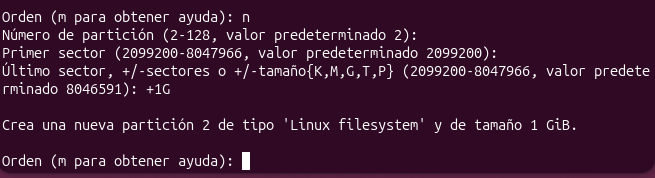

Després vaig canviar el tipus de la partició 3 a **Microsoft basic data**
i el de la 4 a **Linux swap** (ordre `t`, i `L` per buscar el número de
cada tipus a la llista). El resultat final, abans de desar:
```
p
```
```
Dispositiu   Comienzo    Final  Sectores Tamaño Tipo
/dev/sdc1        2048  2099199   2097152     1G Sistema de ficheros de Linux
/dev/sdc2     2099200  4196351   2097152     1G Sistema de ficheros de Linux
/dev/sdc3     4196352  5244927   1048576   512M Datos básicos de Microsoft
/dev/sdc4     5244928  8046591   2801664   1,3G Linux swap
```

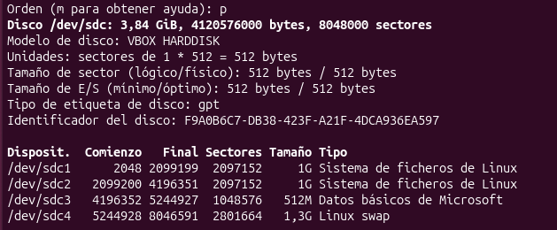

Amb `w` ho vaig desar al disc.

En voler formatar les particions, totes quatre em van sortir com a
"aparentement en ús pel sistema" (ni `partprobe` ni mirar amb `fuser` qui
les tenia bloquejades hi van trobar cap procés), així que vaig haver de
reiniciar la màquina. Després del reinici ja es van poder formatar sense
problema:
```
sudo mkfs.ext4 -b 4096 -L projectes /dev/sdc1
sudo mkfs.ext4 -b 1024 -L petits /dev/sdc2
```

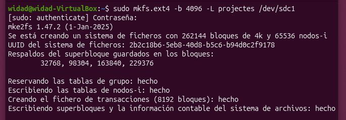

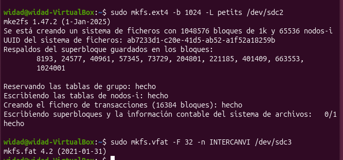

Vaig acabar de formatar la partició 3 (FAT32) i activar la 4 com a swap:
```
sudo mkfs.vfat -F 32 -n INTERCANVI /dev/sdc3
sudo mkswap -L swapextra /dev/sdc4
sudo swapon /dev/sdc4
sudo mkdir -p /srv/projectes /srv/petits /mnt/intercanvi
```

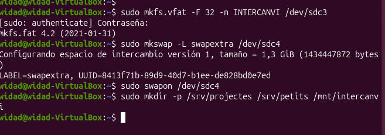

Per muntar-ho de forma permanent, vaig consultar el UUID de cada partició i
afegir-los a `/etc/fstab`:
```
sudo blkid /dev/sdc1 /dev/sdc2 /dev/sdc3 /dev/sdc4
sudo nano /etc/fstab
```

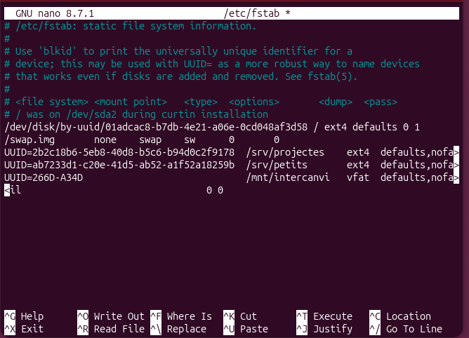

```
UUID=2b2c18b6-5eb8-40d8-b5c6-b94d0c2f9178  /srv/projectes    ext4  defaults,nofail                             0 2
UUID=ab7233d1-c20e-41d5-ab52-a1f52a18259b  /srv/petits       ext4  defaults,nofail                             0 2
UUID=266D-A34D                             /mnt/intercanvi   vfat  defaults,nofail,uid=1000,gid=1000,umask=022  0 0
UUID=8413f71b-89d9-40d7-b1ee-de828bd0e7ed  none              swap  sw,nofail                                   0 0
```

Després ho vaig comprovar sense reiniciar:
```
sudo systemctl daemon-reload
sudo findmnt --verify
sudo mount -a
df -hT | grep sdc
```

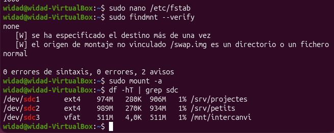

`findmnt --verify` només va donar dos avisos normals (tenir dues entrades
de swap amb `none` com a destí, i l'avís de l'swap.img que ja hi havia
abans d'Ubuntu), cap error. `df -hT` confirma que `sdc1`, `sdc2` i `sdc3`
ja estan muntats al seu lloc.

Amb `cat /etc/fstab` vaig revisar que les quatre línies havien quedat bé:

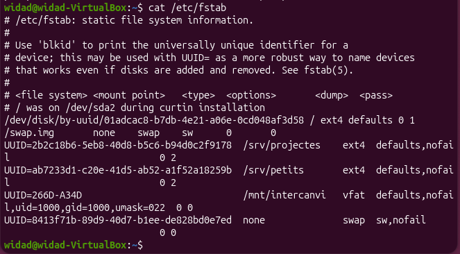

I amb `swapon --show` vaig confirmar que la swap nova ja estava activa:
```
swapon --show
```

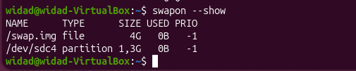

Encara em falta fer la prova final reiniciant la màquina, per veure que
tot es munta sol sense fer `mount -a` a mà.

## Recuperació de fitxers després d'un formateig

Pràctica independent per comprovar que formatar un disc no esborra els fitxers
de seguida: només esborra l'índex que diu on és cadascun.

### Preparació: tres fitxers de prova

Vaig crear la carpeta `~/practica` i hi vaig posar tres fitxers: una foto i un PDF
copiats amb l'aplicació Fitxers, i un text creat directament des del terminal amb
`echo`:
```
echo "El meu secret és que m'encanta la pizza amb pinya" > notes.txt
```


Després en vaig calcular el hash amb `sha256sum`, per poder comprovar més endavant
que els fitxers recuperats són exactament els mateixos:
```
sha256sum foto.jpg apunts.pdf notes.txt > originals.sha
cat originals.sha
```


### Creació del disc virtual

Vaig crear un fitxer de 200 MB ple de zeros, que fa de disc durant tota la
pràctica:
```
dd if=/dev/zero of=disc.img bs=1M count=200 status=progress
ls -lh disc.img
```


### Formatar, muntar i copiar-hi els fitxers

Vaig formatar el disc virtual amb ext4:
```
mkfs.ext4 disc.img
```


Després el vaig muntar i hi vaig copiar els tres fitxers:
```
sudo mkdir -p /mnt/prova
sudo mount -o loop disc.img /mnt/prova
sudo cp foto.jpg apunts.pdf notes.txt /mnt/prova/
ls -l /mnt/prova
```


### Formateig d'alt nivell

Vaig desmuntar el disc i el vaig tornar a formatar (com si volgués reutilitzar un
USB), confirmant l'avís perquè ja tenia un sistema de fitxers:
```
sudo umount /mnt/prova
mkfs.ext4 -E nodiscard disc.img
```
Després vaig muntar-lo de nou per veure què hi quedava:
```
sudo mount -o loop disc.img /mnt/prova
ls -l /mnt/prova
sudo umount /mnt/prova
```


Els fitxers han desaparegut de l'índex i el disc sembla buit, però encara hi
són físicament — això ho vaig comprovar al pas següent amb `photorec`.

### Recuperació amb photorec

Vaig executar `photorec` sobre el disc, sense necessitar l'índex que s'havia
esborrat:
```
photorec /d recup /cmd disc.img options,fileopt,everything,enable,search
```


Com que vaig activar la recuperació de **tots** els tipus de fitxer
(`everything`), `photorec` també va interpretar com a vàlids molts blocs buits
del disc (zeros) com si fossin capçaleres d'un format de correu (`.dovecot`),
cosa que va generar milers de falsos positius. A més, `photorec` crea una
carpeta nova cada cert nombre de fitxers trobats, així que en comptes d'una sola
carpeta `recup.1` en van sortir sis:
```
ls -d recup.*
```


Encara em falta localitzar la foto i el PDF reals entre tots els falsos
positius i comprovar amb `sha256sum` que són idèntics als originals, buscar
el text de `notes.txt` directament dins del disc amb `strings | grep` (ja
que `photorec` no reconeix fitxers de text sense capçalera), i finalment
omplir tot el disc de zeros per comprovar que, aquesta vegada, ni `photorec`
ni la cerca de text troben res.

També he instal·lat el paquet `testdisk` (que porta el `photorec`) en un
altre ordinador, per tenir-lo a mà per si el faig servir en aquesta part:

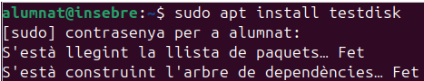

### Repetició de la pràctica a l'ordinador de l'institut

Vaig continuar aquesta part a l'ordinador de l'institut, repetint des de
zero la preparació perquè és una màquina diferent del meu portàtil. Vaig
crear la carpeta `~/practica` i hi vaig tornar a posar els mateixos tres
fitxers:
```
mkdir -p ~/practica
cd ~/practica
pwd
```

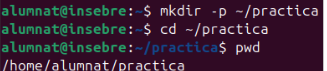

```
echo "El meu secret és que m'encanta la pizza amb pinya" > notes.txt
```

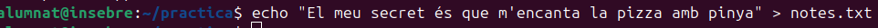

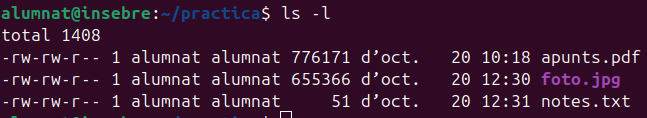

Després vaig tornar a crear i formatar el disc virtual de 200 MB:
```
dd if=/dev/zero of=disc.img bs=1M count=200 status=progress
ls -lh disc.img
mkfs.ext4 disc.img
```

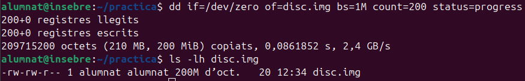

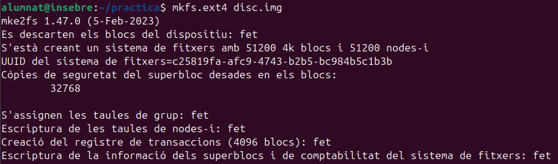

## Gestió de processos

Missió «El servidor va lent»: com a administrador d'un servidor Ubuntu, cal
trobar quins processos sospitosos hi ha, investigar-los amb `ps`, passar la
descàrrega legítima a segon pla, donar-li prioritat i neutralitzar els intrusos.

Conceptes clau: un **procés** és un programa mentre s'executa, amb un **PID**
(identificador únic) i un **PPID** (el PID del seu procés pare); si el pare
acaba abans, el procés queda orfe i l'adopta `systemd`. Un procés en **primer
pla** ocupa el terminal; en **segon pla** (`&`) el deixa lliure. Els **senyals**
(`SIGTERM`, `SIGKILL`, `SIGSTOP`, `SIGCONT`...) serveixen per demanar-li a un
procés que acabi, que es pari o que continuï. La **prioritat** (`nice`/`renice`)
decideix quant de CPU rep un procés quan n'hi ha diversos competint.

Vaig crear la carpeta `~/missio` i els cinc scripts del sabotatge (`minador`,
`espia`, `backup_nocturn`, `descarrega.sh` i `sospitosos.sh`), però encara em
falta fer i documentar tota la resta de la missió (reconeixement amb `ps` i
`pstree`, trobar qui consumeix més amb `top`, filtrar amb `grep`/`pgrep`,
moure la descàrrega entre primer i segon pla, pujar-li la prioritat, i
neutralitzar els intrusos amb els senyals adequats).

## Gestió de permisos

Missió «PixelForge» (3a part): a l'estudi de videojocs tothom pot llegir i
esborrar els fitxers de tothom, i el codi del joc ha quedat obert a tot
l'estudi. M'ha tocat posar-hi ordre: donar a cada equip la seva carpeta, fer
que els fitxers nous surtin del grup correcte, protegir una carpeta
compartida i donar accés puntual a algú de fora de l'equip.

Cada fitxer té tres permisos (`r` llegir, `w` escriure, `x`
executar/entrar-hi) per a tres destinataris: propietari (`u`), grup (`g`) i
resta (`o`). Es poden escriure en lletres (`-rwxr-xr--`) o en número, sumant
`r`=4, `w`=2, `x`=1 per cada grup de tres; així `chmod 750` és propietari
`rwx`, grup `r-x`, resta sense res. A més hi ha tres permisos especials: el
**SUID** fa que un programa s'executi amb la identitat del seu propietari;
el **SGID** fa que els fitxers nous d'una carpeta heretin el grup de la
carpeta; i el **sticky bit** deixa que tothom creï fitxers en una carpeta
compartida però que cadascú només pugui esborrar els seus (com a `/tmp`).

Vaig començar creant els usuaris i grups que em feien falta, perquè encara
no els tenia de cap pràctica anterior:
```
sudo groupadd programadors
sudo groupadd artistes
sudo groupadd testers
sudo adduser nvidal
sudo adduser pau
sudo adduser marc
sudo adduser biel
sudo usermod -aG programadors nvidal
sudo usermod -aG programadors pau
sudo usermod -aG testers marc
```


**Nivell 0.** Vaig muntar l'estudi: una carpeta per `/srv/pixelforge` amb
una subcarpeta per equip (`codi`, `art`, `proves`) i una de compartida, amb
un fitxer d'exemple a cada una:
```
sudo mkdir -p /srv/pixelforge
cd /srv/pixelforge
sudo mkdir codi art proves compartit
sudo touch codi/joc.py art/logo.png proves/informe.txt
ls -l /srv/pixelforge
```


Tot surt de `root root` perquè ho he creat amb `sudo`; en els nivells
següents ho vaig donant a cada equip.

**Nivell 1.** Abans de canviar res, vaig practicar llegint permisos: els del
fitxer `joc.py` (`644`, el propietari llegeix i escriu, la resta només
llegeix), els de la carpeta `codi` mateixa amb `-d` (`755`, tothom hi entra
però només `root` hi crea fitxers), i els mateixos amb `stat`, que els dona
en lletres i en número alhora:
```
ls -l /srv/pixelforge/codi/joc.py
ls -ld /srv/pixelforge/codi
stat /srv/pixelforge/codi/joc.py
```


Pel repte 1 vaig mirar dos fitxers crítics del sistema. `/etc/shadow` és
`640` del grup `shadow`: només `root` i els programes d'aquell grup (com
`passwd`) el poden llegir. `/root` és `700`: ni tan sols el grup hi té cap
permís, només el propietari.
```
ls -l /etc/shadow
ls -ld /root
```


**Nivell 2.** Amb números, vaig posar `750` a `codi` (amb `-R`, perquè
s'apliqui també al fitxer de dins), `755` a `art` i `640` al fitxer privat
`proves/informe.txt`:
```
sudo chmod -R 750 /srv/pixelforge/codi
ls -ld /srv/pixelforge/codi
ls -l /srv/pixelforge/codi
sudo chmod 755 /srv/pixelforge/art
sudo chmod 640 /srv/pixelforge/proves/informe.txt
ls -l /srv/pixelforge/proves
```


**Repte 2.** Calculant el número perquè el propietari fes de tot, el grup
pogués entrar i crear fitxers (sense llegir) i la resta només entrar i
llegir, em va sortir `735`:
```
sudo chmod 735 /srv/pixelforge/compartit
ls -ld /srv/pixelforge/compartit
```

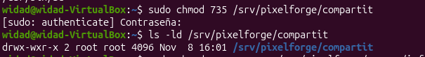

**Nivell 3.** Amb lletres, en canvi, es poden tocar permisos un a un sense
recalcular tot el número. A `art` vaig treure la `w` del propietari
(`u-w`), i després vaig deixar la resta sense cap permís (`o=`):
```
sudo chmod u-w /srv/pixelforge/art
ls -ld /srv/pixelforge/art
sudo chmod u+w /srv/pixelforge/art
sudo chmod o= /srv/pixelforge/art
ls -ld /srv/pixelforge/art
sudo chmod g+rx,o-w /srv/pixelforge/art
```


**Repte 3.** Amb una sola ordre amb lletres, vaig deixar `informe.txt` amb
propietari llegir+escriure, grup només llegir i resta sense res — coincideix
amb `640`:
```
sudo chmod u=rw,g=r,o= /srv/pixelforge/proves/informe.txt
ls -l /srv/pixelforge/proves/informe.txt
```

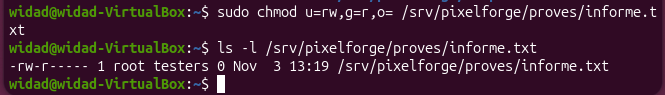

**Nivell 4.** Vaig donar `codi` a en Pau i al grup `programadors`, i vaig
canviar només el grup de `proves` a `testers`:
```
sudo chown -R pau:programadors /srv/pixelforge/codi
ls -l /srv/pixelforge
sudo chgrp -R testers /srv/pixelforge/proves
ls -ld /srv/pixelforge/proves
```


Per comprovar-ho, vaig entrar com a `pau`: va poder crear un fitxer a
`codi` sense problema, però a `proves` li va sortir `Permission denied`.
```
su - pau
cd /srv/pixelforge/codi
touch nivell1.py
ls -l
touch /srv/pixelforge/proves/intrus.txt
exit
```


**Repte 4.** Vaig posar en Biel al grup `artistes` i li vaig donar la
carpeta `art`:
```
sudo usermod -aG artistes biel
sudo chown -R biel:artistes /srv/pixelforge/art
id biel
ls -ld /srv/pixelforge/art
```

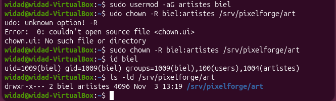

**Nivell 5.** El problema de l'SGID: amb `codi` ja amb permís d'escriptura
pel grup, quan la Núria (`nvidal`, del grup `programadors`) hi crea un
fitxer, surt del seu grup personal (`nvidal`), no de `programadors`:
```
sudo chmod g+w /srv/pixelforge/codi
ls -ld /srv/pixelforge/codi
su - nvidal
touch /srv/pixelforge/codi/mapa.py
ls -l /srv/pixelforge/codi
exit
```


Posant el bit SGID a la carpeta (la `s` a `drwxrws---`), els fitxers nous ja
surten del grup `programadors` — el fitxer antic `mapa.py` es queda com
estava, perquè l'SGID només afecta el que es crea després:
```
sudo chmod g+s /srv/pixelforge/codi
ls -ld /srv/pixelforge/codi
su - nvidal
touch /srv/pixelforge/codi/so.py
ls -l /srv/pixelforge/codi
exit
```


**Repte 5.** Vaig fer el mateix amb `proves`: permís d'escriptura pel grup
i SGID, i vaig comprovar amb en Marc que els fitxers nous ja surten del
grup `testers`:
```
sudo chmod g+w /srv/pixelforge/proves
sudo chmod g+s /srv/pixelforge/proves
ls -ld /srv/pixelforge/proves
su - marc
touch /srv/pixelforge/proves/test1.py
exit
```

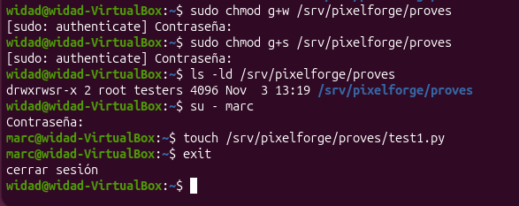

```
ls -l /srv/pixelforge/proves
```

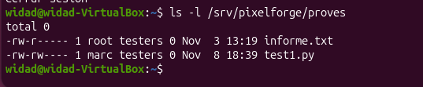

**Nivell 6.** Vaig preparar `compartit` amb `777` perquè tothom hi pogués
escriure, i vaig comprovar el problema de no tenir sticky bit: en Marc va
poder esborrar un fitxer d'en Pau només confirmant-ho (`rm` el deixa fer,
només pregunta):
```
sudo chmod 777 /srv/pixelforge/compartit
su - pau
touch /srv/pixelforge/compartit/de_pau.txt
exit
su - marc
rm /srv/pixelforge/compartit/de_pau.txt
```


Vaig posar el sticky bit amb `chmod +t`: a `ls -ld` ja surt la `t` al final
(`drwxrwxrwt`).
```
sudo chmod +t /srv/pixelforge/compartit
ls -ld /srv/pixelforge/compartit
```

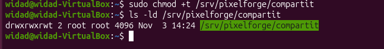

Per comprovar-ho, en Pau va tornar a crear el fitxer i en Marc va provar
d'esborrar-lo igual que abans. Aquesta vegada `rm` ho demana i, encara que
respongui que sí, el sistema no ho deixa: `Operación no permitida`.
```
touch /srv/pixelforge/compartit/de_pau.txt
exit
su - marc
rm /srv/pixelforge/compartit/de_pau.txt
```

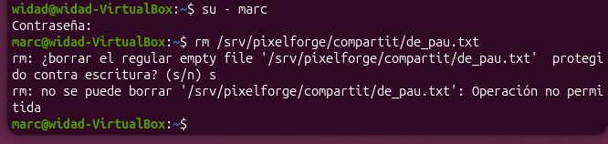

**Repte 6.** Al fer el repte 2 vaig tocar els permisos de `compartit` i, sense
voler, vaig perdre el `777` + sticky bit que havia posat en aquest nivell.
Ho vaig haver de restaurar (`chmod 1777`, que és `777` amb sticky bit en un
sol pas) abans de poder demostrar que en Marc sí que pot esborrar un fitxer
seu:
```
sudo chmod 1777 /srv/pixelforge/compartit
ls -ld /srv/pixelforge/compartit
su - marc
touch /srv/pixelforge/compartit/de_marc.txt
rm /srv/pixelforge/compartit/de_marc.txt
exit
```

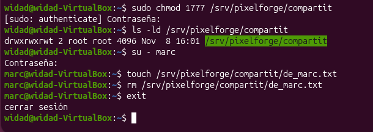

**Nivell 7.** En Marc, dels testers, havia de poder entrar un moment a
`codi` sense posar-lo al grup `programadors`. Primer vaig comprovar que no
hi podia entrar (`Permiso denegado`), i després li vaig donar accés amb una
ACL:
```
su - marc
ls /srv/pixelforge/codi
exit
sudo setfacl -m u:marc:rx /srv/pixelforge/codi
ls -ld /srv/pixelforge/codi
getfacl /srv/pixelforge/codi
```

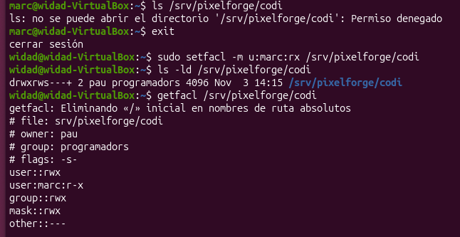

Amb l'ACL posada, en Marc ja podia llistar `codi`. Un cop acabada la
revisió, li vaig treure l'accés i vaig comprovar que l'entrada havia
desaparegut de `getfacl`:
```
su - marc
ls /srv/pixelforge/codi
exit
sudo setfacl -x u:marc /srv/pixelforge/codi
getfacl /srv/pixelforge/codi
```

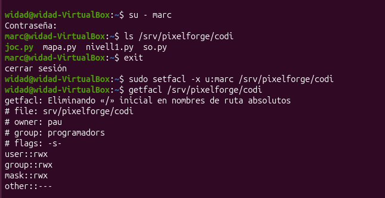

**Repte 7.** Vaig posar una ACL per defecte a `compartit` perquè el grup
`artistes` tingui sempre `rwx` sobre els fitxers nous que s'hi creïn:
```
sudo setfacl -d -m g:artistes:rwx /srv/pixelforge/compartit
getfacl /srv/pixelforge/compartit
```

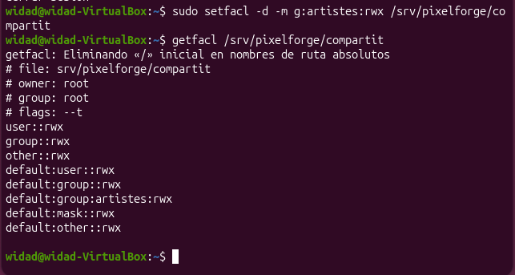

**Nivell 8, part A.** Amb la màscara per defecte (`0002`), un fitxer nou
surt `664` i una carpeta `775` — el grup hi pot escriure perquè el meu
grup personal només sóc jo. Canviant la màscara a `027`, en canvi, el
fitxer surt `640` i la carpeta `750`: la resta d'usuaris es queda sense
cap permís.
```
umask
cd ~
touch prova_umask.txt
mkdir prova_umask_dir
ls -ld prova_umask.txt prova_umask_dir
```

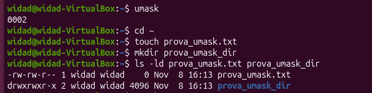

```
umask 027
touch prova2.txt
mkdir prova2_dir
ls -ld prova2.txt prova2_dir
```

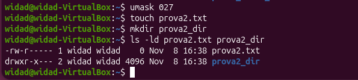

**Nivell 8, part B.** `/usr/bin/passwd` té una `s` on aniria la `x` del
propietari (`-rwsr-xr-x`): és el bit SUID, i el propietari és `root`. Per
això, quan un usuari normal executa `passwd` per canviar la seva
contrasenya (que vol dir escriure a `/etc/shadow`, que només `root` pot
tocar), el programa s'executa momentàniament com a `root`.
```
ls -l /usr/bin/passwd
find /usr/bin -perm -4000 2>/dev/null
```

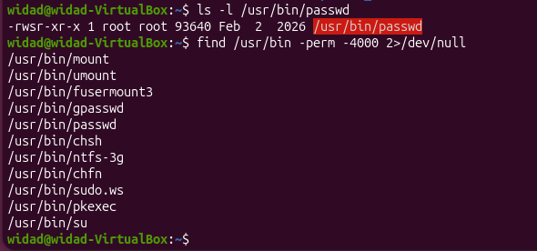

**Repte 8.** Amb la màscara `137`, vaig calcular sobre paper que el fitxer
sortiria `640` i la carpeta també `640` — sense la `x` del propietari. Ho
vaig comprovar creant-los i intentant entrar-hi:
```
umask 137
touch provaestranya.txt
mkdir provaestranya_dir
ls -ld provaestranya.txt provaestranya_dir
cd provaestranya_dir
```

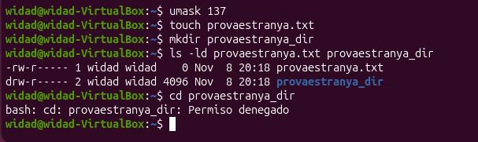

És una màscara estranya perquè, sense el bit `x`, ni tan sols la
propietària pot entrar a la seva pròpia carpeta nova (`cd` dona
`Permiso denegado`), tot i tenir-ne la propietat.

Amb això la missió PixelForge (gestió de permisos) queda completament
acabada: els nou nivells i els vuit reptes.
