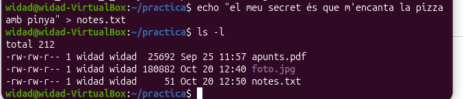
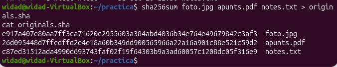
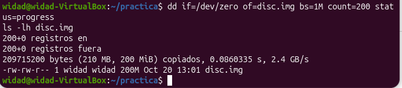
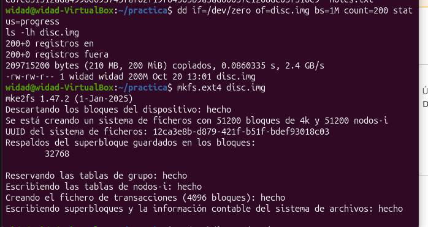
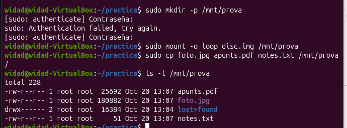
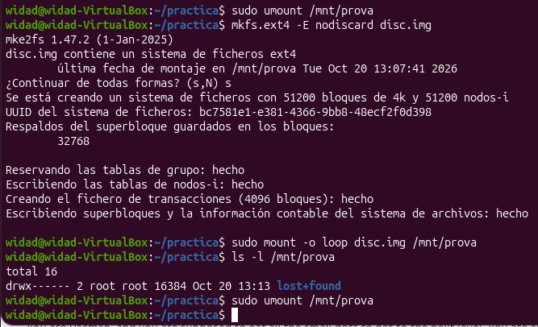
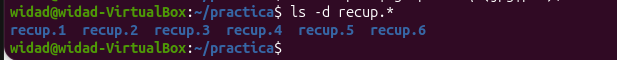

## Particions i sistemes de fitxers

Un disc nou no es pot fer servir directament: primer es **parteix** (es crea la taula
de particions), després es **formata** cada partició (se li posa un sistema de
fitxers) i finalment es **munta** en una carpeta de l'arbre de Linux.

### Conceptes bàsics

- **Disc**: el dispositiu sencer, físic o virtual (`/dev/sda`, `/dev/sdb`...).
- **Taula de particions**: l'índex al principi del disc que diu on comença i on
  acaba cada partició (MBR o GPT).
- **Partició**: un tros continu del disc que el sistema tracta com un disc
  independent (`/dev/sdb1`).
- **Sistema de fitxers**: l'estructura que es posa a la partició en formatar-la
  perquè s'hi puguin guardar fitxers i carpetes (ext4, NTFS, FAT32...).
- **Sector**: la unitat física més petita que el disc pot llegir o escriure (512
  bytes tradicionalment, 4096 bytes als discos moderns).
- **Bloc**: la unitat amb què treballa el sistema de fitxers, un grup de sectors
  consecutius (normalment 4096 bytes a ext4). Un fitxer sempre ocupa blocs sencers,
  encara que no els ompli del tot — l'espai que es perd es diu **fragmentació
  interna**.
- **Punt de muntatge**: la carpeta de l'arbre de Linux on s'entra al contingut
  d'una partició (`/var/particio1`). A Linux no hi ha lletres com `C:` o `D:`.

### Pla: l'exercici del disc del servidor de l'acadèmia

L'exercici consisteix a afegir un disc nou de 3 GB a la màquina virtual d'Ubuntu i
crear-hi una taula GPT amb quatre particions:

| Partició | Mida | Sistema | Bloc | Etiqueta | Punt de muntatge |
|---|---|---|---|---|---|
| sdc1 | 1 GiB | ext4 | 4096 | projectes | /srv/projectes |
| sdc2 | 1 GiB | ext4 | 1024 | petits | /srv/petits |
| sdc3 | 512 MiB | FAT32 | per defecte | INTERCANVI | /mnt/intercanvi |
| sdc4 | la resta | swap | — | swapextra | (cap, la swap no en té) |

Passos:

1. Fer una instantània de la VM d'Ubuntu i afegir un disc nou de 3 GB al
   controlador SATA.
2. Anotar la mida del disc en bytes i en sectors, i la mida de sector lògic i
   físic, amb `lsblk -o NAME,SIZE,LOG-SEC,PHY-SEC /dev/sdc` i `sudo fdisk -l
   /dev/sdc`.
3. Crear la taula GPT amb `sudo fdisk /dev/sdc` i les quatre particions de la
   taula.
4. Formatar cada partició amb el sistema i la mida de bloc indicats, i activar la
   swap.
5. Muntar-ho tot de forma permanent amb `/etc/fstab` (UUID i `nofail`), reiniciar
   i comprovar-ho.
6. Experiment de fragmentació interna: crear 1000 fitxers de 100 bytes a
   `/srv/projectes` i a `/srv/petits`, i comparar amb `du` l'espai real ocupat a
   cada partició.

Cal lliurar:

- Captura de `lsblk -o NAME,SIZE,LOG-SEC,PHY-SEC /dev/sdc` i de `sudo fdisk -l
  /dev/sdc`.
- Captura de `lsblk -f /dev/sdc` i de `cat /etc/fstab`.
- Captura de `df -hT` i `swapon --show` fetes després de reiniciar.
- Captura de les dues ordres `du` de l'experiment de fragmentació.
- Respostes a les sis preguntes de l'exercici, amb la taula de fragmentació
  plena.

## Recuperació de fitxers després d'un formateig

Pràctica independent per comprovar que formatar un disc no esborra els fitxers
de seguida: només esborra l'índex que diu on és cadascun.

### Preparació: tres fitxers de prova

Vaig crear la carpeta `~/practica` i hi vaig posar tres fitxers: una foto i un PDF
copiats amb l'aplicació Fitxers, i un text creat directament des del terminal amb
`echo`:
```
echo "El meu secret és que m'encanta la pizza amb pinya" > notes.txt
```



Després en vaig calcular el hash amb `sha256sum`, per poder comprovar més endavant
que els fitxers recuperats són exactament els mateixos:
```
sha256sum foto.jpg apunts.pdf notes.txt > originals.sha
cat originals.sha
```



### Creació del disc virtual

Vaig crear un fitxer de 200 MB ple de zeros, que fa de disc durant tota la
pràctica:
```
dd if=/dev/zero of=disc.img bs=1M count=200 status=progress
ls -lh disc.img
```



### Formatar, muntar i copiar-hi els fitxers

Vaig formatar el disc virtual amb ext4:
```
mkfs.ext4 disc.img
```



Després el vaig muntar i hi vaig copiar els tres fitxers:
```
sudo mkdir -p /mnt/prova
sudo mount -o loop disc.img /mnt/prova
sudo cp foto.jpg apunts.pdf notes.txt /mnt/prova/
ls -l /mnt/prova
```



### Formateig d'alt nivell

Vaig desmuntar el disc i el vaig tornar a formatar (com si volgués reutilitzar un
USB), confirmant l'avís perquè ja tenia un sistema de fitxers:
```
sudo umount /mnt/prova
mkfs.ext4 -E nodiscard disc.img
```
Després vaig muntar-lo de nou per veure què hi quedava:
```
sudo mount -o loop disc.img /mnt/prova
ls -l /mnt/prova
sudo umount /mnt/prova
```



Els fitxers han desaparegut de l'índex i el disc sembla buit, però encara hi
són físicament — això ho vaig comprovar al pas següent amb `photorec`.

### Recuperació amb photorec

Vaig executar `photorec` sobre el disc, sense necessitar l'índex que s'havia
esborrat:
```
photorec /d recup /cmd disc.img options,fileopt,everything,enable,search
```


Com que vaig activar la recuperació de **tots** els tipus de fitxer
(`everything`), `photorec` també va interpretar com a vàlids molts blocs buits
del disc (zeros) com si fossin capçaleres d'un format de correu (`.dovecot`),
cosa que va generar milers de falsos positius. A més, `photorec` crea una
carpeta nova cada cert nombre de fitxers trobats, així que en comptes d'una sola
carpeta `recup.1` en van sortir sis:
```
ls -d recup.*
```



Pla per a la resta de la pràctica:

1. Localitzar la foto i el PDF reals entre tots els falsos positius, i
   comprovar amb `sha256sum` que són idèntics als originals, byte a byte.
2. Buscar el text de `notes.txt` directament dins del disc amb `strings | grep`,
   ja que `photorec` no reconeix fitxers de text sense capçalera.
3. Omplir tot el disc de zeros (formateig de baix nivell) i tornar a provar
   `photorec` i la cerca de text: aquesta vegada no ha de trobar res.

Cal lliurar:

- Captura dels hashes dels tres fitxers originals.
- Captura del disc amb només `lost+found` després del formateig.
- Captura dels hashes dels fitxers recuperats i dels originals, iguals.
- Captura de la frase trobada dins del disc.
- Captura de `photorec` sense cap fitxer i de `grep` sense resultat, després
  d'omplir el disc de zeros.
- Respostes a les sis preguntes de la pràctica.

## Gestió de processos

Missió «El servidor va lent»: com a administrador d'un servidor Ubuntu, cal
trobar quins processos sospitosos hi ha, investigar-los amb `ps`, passar la
descàrrega legítima a segon pla, donar-li prioritat i neutralitzar els intrusos.

Conceptes clau: un **procés** és un programa mentre s'executa, amb un **PID**
(identificador únic) i un **PPID** (el PID del seu procés pare); si el pare
acaba abans, el procés queda orfe i l'adopta `systemd`. Un procés en **primer
pla** ocupa el terminal; en **segon pla** (`&`) el deixa lliure. Els **senyals**
(`SIGTERM`, `SIGKILL`, `SIGSTOP`, `SIGCONT`...) serveixen per demanar-li a un
procés que acabi, que es pari o que continuï. La **prioritat** (`nice`/`renice`)
decideix quant de CPU rep un procés quan n'hi ha diversos competint.

Pla de la missió, en vuit nivells:

1. **Preparar el cas**: crear la carpeta `~/missio` i cinc scripts (`minador`,
   `espia`, `backup_nocturn`, `descarrega.sh`, `sospitosos.sh`), donar-los
   permís d'execució i engegar el sabotatge.
2. **Reconeixement**: veure els processos propis i de tot el sistema amb `ps` i
   `pstree`, i localitzar els sospitosos penjant de `systemd`.
3. **Qui consumeix més**: usar `top` per trobar que els dos `minador` es
   reparteixen tota la CPU.
4. **Interrogatori amb ps**: filtrar la llista amb `grep`/`pgrep` per obtenir
   els PID de cada sospitós i les seves dades (`PPID`, estat, `%CPU`...).
5. **La descàrrega urgent**: moure `descarrega.sh` entre primer pla, pausa
   (`Ctrl+Z`) i segon pla (`bg`/`fg`) mentre es vigila el progrés en un segon
   terminal.
6. **Prioritat a la descàrrega**: pujar-li la prioritat amb `sudo renice` per
   fer-la acabar abans que els `minador`.
7. **Neutralitzar els intrusos**: aturar els `minador` amb `kill`, l'`espia`
   amb `kill -9` (ignora `SIGTERM`), i pausar/reprendre el `backup_nocturn` amb
   `kill -STOP`/`kill -CONT`.
8. **Que la descàrrega no es perdi**: comprovar que tancar el terminal mata la
   descàrrega (rep `SIGHUP`), i que executant-la amb `nohup ... &` sobreviu i
   l'adopta `systemd`.

Cal lliurar vuit captures (una per nivell, segons indica la guia de la missió)
i, en acabar, aturar tots els processos de la missió que quedin engegats.

## Gestió de permisos

Missió «PixelForge» (3a part): l'estudi de videojocs ja té els usuaris i els
equips creats, però els permisos estan mal configurats — tothom pot llegir i
esborrar els fitxers de tothom, i el codi del joc ha quedat obert a tot
l'estudi. Cal donar a cada equip la seva carpeta, fer que els fitxers nous
siguin del grup correcte, protegir una carpeta compartida i donar accés
puntual a algú de fora de l'equip.

### Resum de teoria

Cada fitxer i cada carpeta té tres **permisos** (`r` llegir, `w` escriure,
`x` executar/entrar) que es poden donar a tres **destinataris**: `u`
(propietari), `g` (grup) i `o` (resta). En una carpeta, `x` és el que permet
entrar-hi (`cd`) i accedir als fitxers de dins; amb `r` però sense `x` només
es veuen els noms.

Una línia de `ls -l` com `-rwxr-xr--` es llegeix: tipus (`-` fitxer, `d`
carpeta, `l` enllaç), després tres grups de `rwx` per a propietari, grup i
resta.

Els permisos també es poden escriure en número, sumant els valors de cada
grup (`r`=4, `w`=2, `x`=1): `rwx`=7, `r-x`=5, `rw-`=6, `r--`=4, etc. Així
`chmod 750` vol dir propietari `rwx`, grup `r-x`, resta `---`. Els més
habituals: `755` (programes i carpetes públiques), `750` (carpeta d'un
equip), `644` (fitxers normals), `640` (fitxers privats d'un equip).

A més hi ha tres **permisos especials**, amb un quart dígit davant del
número o com a lletra extra als permisos normals:

- **SUID** (4, `u+s`): el programa s'executa amb la identitat del propietari,
  no de qui el llança. Es veu com una `s` a la zona de l'usuari.
- **SGID** (2, `g+s`): en una carpeta, els fitxers nous hereten el grup de
  la carpeta. Es veu com una `s` a la zona del grup.
- **Sticky bit** (1, `+t`): en una carpeta compartida, tothom hi pot crear
  fitxers però cadascú només pot esborrar els seus. Es veu com una `t` al
  final. El cas més conegut és `/tmp`.

Ordres principals: `ls -l`/`ls -la` (llista amb permisos), `ls -ld carpeta`
(permisos de la carpeta mateixa, no del que conté), `stat fitxer` (permisos
en lletres i número), `getfacl fitxer` (permisos ACL); `chmod` (numèric o
simbòlic, amb `u`/`g`/`o`/`a` i `+`/`-`/`=`); `chown usuari:grup` i `chgrp
grup` (canviar propietari/grup, només amb `sudo`); `setfacl -m u:usuari:rwx`
i `setfacl -x u:usuari` (donar/treure accés ACL a una persona concreta sense
canviar-la de grup); `umask` (la màscara que decideix els permisos per
defecte dels fitxers nous: es resta de 666 per a fitxers i 777 per a
carpetes).

### Pla de la pràctica

Com que encara no tinc creats els usuaris i grups de PixelForge, primer cal
crear-los:
```
sudo groupadd programadors
sudo groupadd artistes
sudo groupadd testers
sudo adduser nvidal
sudo adduser pau
sudo adduser marc
sudo adduser biel
sudo usermod -aG programadors nvidal
sudo usermod -aG programadors pau
sudo usermod -aG testers marc
```

Després, la missió es fa en nou nivells, dins de `/srv/pixelforge`:

1. **Muntar l'estudi**: crear `/srv/pixelforge` amb les carpetes `codi`,
   `art`, `proves` i `compartit`, i un fitxer d'exemple a cada carpeta
   d'equip.
2. **Llegir permisos**: interpretar la sortida de `ls -l`, `ls -ld` i `stat`
   sense canviar res encara.
3. **chmod numèric**: posar `750` a `codi`, `755` a `art` i `640` a
   `proves/informe.txt`.
4. **chmod simbòlic**: treure i tornar a posar permisos a `art` amb `u-w`,
   `u+w`, `o=` i `g+rx,o-w`.
5. **chown i chgrp**: donar `codi` a `pau:programadors` i `proves` al grup
   `testers`, i comprovar que en Pau hi pot escriure però no a `proves`.
6. **SGID a `codi`**: fer que els fitxers nous que hi creï l'equip surtin
   del grup `programadors` en lloc del grup personal de qui els crea.
7. **Sticky bit a `compartit`**: permetre que tothom hi deixi fitxers però
   ningú pugui esborrar els dels altres.
8. **ACL per a en Marc**: donar-li accés puntual de lectura a `codi` sense
   posar-lo al grup `programadors`, i treure-l'hi després.
9. **umask i SUID**: comparar els permisos per defecte amb `umask 002` i
   `umask 027`, i observar el bit SUID del fitxer `/usr/bin/passwd`.

Cada nivell té un repte per fer sola, a més del pas guiat. Cal lliurar nou
captures (una per nivell, amb els reptes inclosos) i, en acabar, es pot
esborrar la carpeta de proves (`sudo rm -r /srv/pixelforge`) però no els
usuaris ni els grups.
