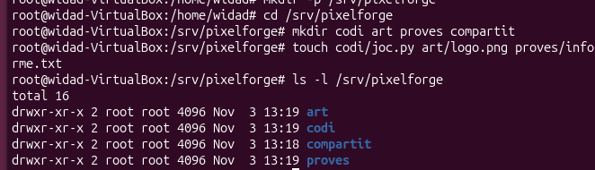
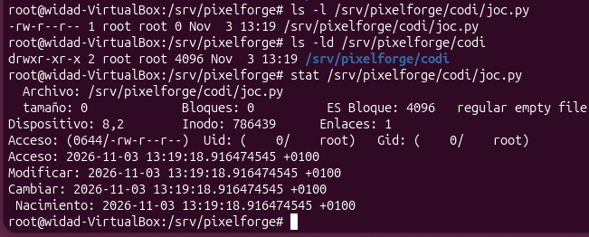
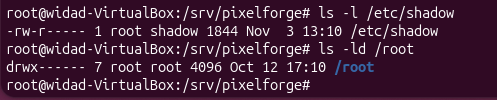
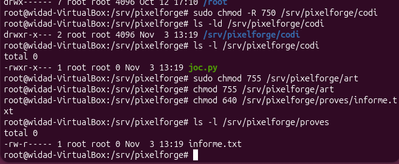
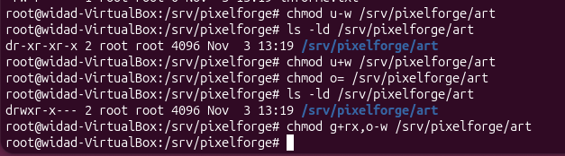
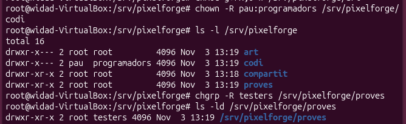
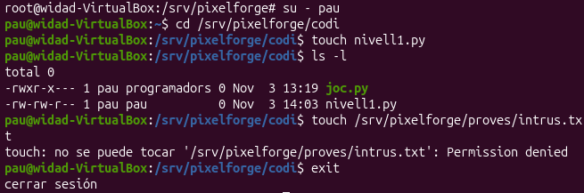
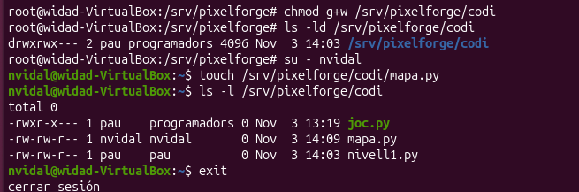
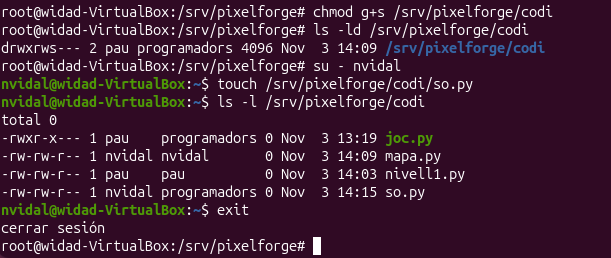
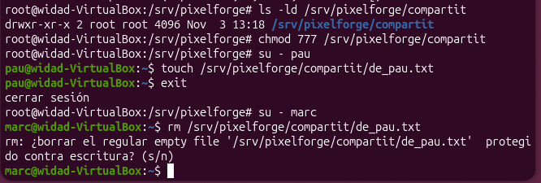

## Particions i sistemes de fitxers

Un disc nou no es pot fer servir directament: primer es **parteix** (es crea la taula
de particions), després es **formata** cada partició (se li posa un sistema de
fitxers) i finalment es **munta** en una carpeta de l'arbre de Linux.

### Conceptes bàsics

- **Disc**: el dispositiu sencer, físic o virtual (`/dev/sda`, `/dev/sdb`...).
- **Taula de particions**: l'índex al principi del disc que diu on comença i on
  acaba cada partició (MBR o GPT).
- **Partició**: un tros continu del disc que el sistema tracta com un disc
  independent (`/dev/sdb1`).
- **Sistema de fitxers**: l'estructura que es posa a la partició en formatar-la
  perquè s'hi puguin guardar fitxers i carpetes (ext4, NTFS, FAT32...).
- **Sector**: la unitat física més petita que el disc pot llegir o escriure (512
  bytes tradicionalment, 4096 bytes als discos moderns).
- **Bloc**: la unitat amb què treballa el sistema de fitxers, un grup de sectors
  consecutius (normalment 4096 bytes a ext4). Un fitxer sempre ocupa blocs sencers,
  encara que no els ompli del tot — l'espai que es perd es diu **fragmentació
  interna**.
- **Punt de muntatge**: la carpeta de l'arbre de Linux on s'entra al contingut
  d'una partició (`/var/particio1`). A Linux no hi ha lletres com `C:` o `D:`.

### L'exercici del disc del servidor de l'acadèmia

Encara em falta fer l'exercici d'afegir un disc nou de 3 GB a la màquina
virtual, amb una taula GPT de quatre particions (una per a projectes grans,
una per a molts fitxers petits, una per intercanviar fitxers amb Windows i
una d'intercanvi de memòria), muntar-ho tot de forma permanent amb
`/etc/fstab`, i fer l'experiment de fragmentació interna comparant l'espai
que ocupen els mateixos fitxers amb mides de bloc diferents.

## Recuperació de fitxers després d'un formateig

Pràctica independent per comprovar que formatar un disc no esborra els fitxers
de seguida: només esborra l'índex que diu on és cadascun.

### Preparació: tres fitxers de prova

Vaig crear la carpeta `~/practica` i hi vaig posar tres fitxers: una foto i un PDF
copiats amb l'aplicació Fitxers, i un text creat directament des del terminal amb
`echo`:
```
echo "El meu secret és que m'encanta la pizza amb pinya" > notes.txt
```


Després en vaig calcular el hash amb `sha256sum`, per poder comprovar més endavant
que els fitxers recuperats són exactament els mateixos:
```
sha256sum foto.jpg apunts.pdf notes.txt > originals.sha
cat originals.sha
```


### Creació del disc virtual

Vaig crear un fitxer de 200 MB ple de zeros, que fa de disc durant tota la
pràctica:
```
dd if=/dev/zero of=disc.img bs=1M count=200 status=progress
ls -lh disc.img
```


### Formatar, muntar i copiar-hi els fitxers

Vaig formatar el disc virtual amb ext4:
```
mkfs.ext4 disc.img
```


Després el vaig muntar i hi vaig copiar els tres fitxers:
```
sudo mkdir -p /mnt/prova
sudo mount -o loop disc.img /mnt/prova
sudo cp foto.jpg apunts.pdf notes.txt /mnt/prova/
ls -l /mnt/prova
```


### Formateig d'alt nivell

Vaig desmuntar el disc i el vaig tornar a formatar (com si volgués reutilitzar un
USB), confirmant l'avís perquè ja tenia un sistema de fitxers:
```
sudo umount /mnt/prova
mkfs.ext4 -E nodiscard disc.img
```
Després vaig muntar-lo de nou per veure què hi quedava:
```
sudo mount -o loop disc.img /mnt/prova
ls -l /mnt/prova
sudo umount /mnt/prova
```


Els fitxers han desaparegut de l'índex i el disc sembla buit, però encara hi
són físicament — això ho vaig comprovar al pas següent amb `photorec`.

### Recuperació amb photorec

Vaig executar `photorec` sobre el disc, sense necessitar l'índex que s'havia
esborrat:
```
photorec /d recup /cmd disc.img options,fileopt,everything,enable,search
```


Com que vaig activar la recuperació de **tots** els tipus de fitxer
(`everything`), `photorec` també va interpretar com a vàlids molts blocs buits
del disc (zeros) com si fossin capçaleres d'un format de correu (`.dovecot`),
cosa que va generar milers de falsos positius. A més, `photorec` crea una
carpeta nova cada cert nombre de fitxers trobats, així que en comptes d'una sola
carpeta `recup.1` en van sortir sis:
```
ls -d recup.*
```


Encara em falta localitzar la foto i el PDF reals entre tots els falsos
positius i comprovar amb `sha256sum` que són idèntics als originals, buscar
el text de `notes.txt` directament dins del disc amb `strings | grep` (ja
que `photorec` no reconeix fitxers de text sense capçalera), i finalment
omplir tot el disc de zeros per comprovar que, aquesta vegada, ni `photorec`
ni la cerca de text troben res.

## Gestió de processos

Missió «El servidor va lent»: com a administrador d'un servidor Ubuntu, cal
trobar quins processos sospitosos hi ha, investigar-los amb `ps`, passar la
descàrrega legítima a segon pla, donar-li prioritat i neutralitzar els intrusos.

Conceptes clau: un **procés** és un programa mentre s'executa, amb un **PID**
(identificador únic) i un **PPID** (el PID del seu procés pare); si el pare
acaba abans, el procés queda orfe i l'adopta `systemd`. Un procés en **primer
pla** ocupa el terminal; en **segon pla** (`&`) el deixa lliure. Els **senyals**
(`SIGTERM`, `SIGKILL`, `SIGSTOP`, `SIGCONT`...) serveixen per demanar-li a un
procés que acabi, que es pari o que continuï. La **prioritat** (`nice`/`renice`)
decideix quant de CPU rep un procés quan n'hi ha diversos competint.

Vaig crear la carpeta `~/missio` i els cinc scripts del sabotatge (`minador`,
`espia`, `backup_nocturn`, `descarrega.sh` i `sospitosos.sh`), però encara em
falta fer i documentar tota la resta de la missió (reconeixement amb `ps` i
`pstree`, trobar qui consumeix més amb `top`, filtrar amb `grep`/`pgrep`,
moure la descàrrega entre primer i segon pla, pujar-li la prioritat, i
neutralitzar els intrusos amb els senyals adequats).

## Gestió de permisos

Missió «PixelForge» (3a part): l'estudi de videojocs ja té els usuaris i els
equips creats, però els permisos estan mal configurats — tothom pot llegir i
esborrar els fitxers de tothom, i el codi del joc ha quedat obert a tot
l'estudi. Cal donar a cada equip la seva carpeta, fer que els fitxers nous
siguin del grup correcte, protegir una carpeta compartida i donar accés
puntual a algú de fora de l'equip.

### Resum de teoria

Cada fitxer i cada carpeta té tres **permisos** (`r` llegir, `w` escriure,
`x` executar/entrar) que es poden donar a tres **destinataris**: `u`
(propietari), `g` (grup) i `o` (resta). En una carpeta, `x` és el que permet
entrar-hi (`cd`) i accedir als fitxers de dins; amb `r` però sense `x` només
es veuen els noms.

Una línia de `ls -l` com `-rwxr-xr--` es llegeix: tipus (`-` fitxer, `d`
carpeta, `l` enllaç), després tres grups de `rwx` per a propietari, grup i
resta.

Els permisos també es poden escriure en número, sumant els valors de cada
grup (`r`=4, `w`=2, `x`=1): `rwx`=7, `r-x`=5, `rw-`=6, `r--`=4, etc. Així
`chmod 750` vol dir propietari `rwx`, grup `r-x`, resta `---`. Els més
habituals: `755` (programes i carpetes públiques), `750` (carpeta d'un
equip), `644` (fitxers normals), `640` (fitxers privats d'un equip).

A més hi ha tres **permisos especials**, amb un quart dígit davant del
número o com a lletra extra als permisos normals:

- **SUID** (4, `u+s`): el programa s'executa amb la identitat del propietari,
  no de qui el llança. Es veu com una `s` a la zona de l'usuari.
- **SGID** (2, `g+s`): en una carpeta, els fitxers nous hereten el grup de
  la carpeta. Es veu com una `s` a la zona del grup.
- **Sticky bit** (1, `+t`): en una carpeta compartida, tothom hi pot crear
  fitxers però cadascú només pot esborrar els seus. Es veu com una `t` al
  final. El cas més conegut és `/tmp`.

Ordres principals: `ls -l`/`ls -la` (llista amb permisos), `ls -ld carpeta`
(permisos de la carpeta mateixa, no del que conté), `stat fitxer` (permisos
en lletres i número), `getfacl fitxer` (permisos ACL); `chmod` (numèric o
simbòlic, amb `u`/`g`/`o`/`a` i `+`/`-`/`=`); `chown usuari:grup` i `chgrp
grup` (canviar propietari/grup, només amb `sudo`); `setfacl -m u:usuari:rwx`
i `setfacl -x u:usuari` (donar/treure accés ACL a una persona concreta sense
canviar-la de grup); `umask` (la màscara que decideix els permisos per
defecte dels fitxers nous: es resta de 666 per a fitxers i 777 per a
carpetes).

### Preparació: usuaris i grups

Com que encara no tenia creats els usuaris i grups de PixelForge, primer els
vaig crear:
```
sudo groupadd programadors
sudo groupadd artistes
sudo groupadd testers
sudo adduser nvidal
sudo adduser pau
sudo adduser marc
sudo adduser biel
sudo usermod -aG programadors nvidal
sudo usermod -aG programadors pau
sudo usermod -aG testers marc
```

Després, la missió es fa en nou nivells, dins de `/srv/pixelforge`.

### Nivell 0 · Muntar l'estudi

Vaig crear la carpeta de l'estudi amb les quatre carpetes (una per equip i
una de compartida) i un fitxer d'exemple a cada carpeta d'equip:
```
sudo mkdir -p /srv/pixelforge
cd /srv/pixelforge
sudo mkdir codi art proves compartit
sudo touch codi/joc.py art/logo.png proves/informe.txt
ls -l /srv/pixelforge
```



Totes les carpetes són de `root root` perquè les he creat amb `sudo`; als
nivells següents els donaré a cada equip.

### Nivell 1 · Llegir permisos

Abans de tocar res, vaig comprovar que sabia llegir els permisos: els del
fitxer `joc.py`, els de la carpeta `codi` mateixa (amb `-d`) i els mateixos
en lletres i en número amb `stat`:
```
ls -l /srv/pixelforge/codi/joc.py
ls -ld /srv/pixelforge/codi
stat /srv/pixelforge/codi/joc.py
```



El fitxer és `644` (`rw-r--r--`): el propietari hi pot llegir i escriure, el
grup i la resta només llegir. La carpeta és `755` (`rwxr-xr-x`): tothom hi
pot entrar i llistar, però només `root` hi pot crear o esborrar fitxers.

**Repte 1**: vaig comprovar els permisos de dos fitxers crítics del sistema:
```
ls -l /etc/shadow
ls -ld /root
```



`/etc/shadow` és `640` (`rw-r-----`), propietari `root` i grup `shadow`:
només `root` (i els processos del grup `shadow`, com `passwd`) el poden
llegir; la resta d'usuaris no hi té cap accés. `/root` és `700`
(`rwx------`): només el propietari (`root`) hi pot entrar, llistar-ne el
contingut o escriure-hi — ni tan sols el grup hi té cap permís.

### Nivell 2 · chmod numèric

Vaig posar `750` a `codi` (amb `-R`, perquè s'apliqui també al fitxer de
dins), `755` a `art` i `640` al fitxer privat `proves/informe.txt`:
```
sudo chmod -R 750 /srv/pixelforge/codi
ls -ld /srv/pixelforge/codi
ls -l /srv/pixelforge/codi
sudo chmod 755 /srv/pixelforge/art
sudo chmod 640 /srv/pixelforge/proves/informe.txt
ls -l /srv/pixelforge/proves
```



### Nivell 3 · chmod simbòlic

Amb lletres, vaig canviar permisos un a un sense recalcular tot el número:
```
sudo chmod u-w /srv/pixelforge/art
ls -ld /srv/pixelforge/art
sudo chmod u+w /srv/pixelforge/art
sudo chmod o= /srv/pixelforge/art
ls -ld /srv/pixelforge/art
sudo chmod g+rx,o-w /srv/pixelforge/art
```



Amb `u-w` ha desaparegut la `w` del propietari sense tocar la resta; amb
`o=` la resta d'usuaris s'ha quedat sense cap permís.

### Nivell 4 · chown i chgrp

Vaig donar la carpeta `codi` a en Pau i al grup `programadors`, i vaig
canviar només el grup de `proves` a `testers`:
```
sudo chown -R pau:programadors /srv/pixelforge/codi
ls -l /srv/pixelforge
sudo chgrp -R testers /srv/pixelforge/proves
ls -ld /srv/pixelforge/proves
```



Després vaig entrar com a `pau` per comprovar-ho:
```
su - pau
cd /srv/pixelforge/codi
touch nivell1.py
ls -l
touch /srv/pixelforge/proves/intrus.txt
exit
```



En Pau, com a propietari de `codi`, hi pot crear fitxers sense problema; a
`proves` no té cap permís i li surt `Permission denied`.

### Nivell 5 · SGID a `codi`

Primer vaig donar permís d'escriptura al grup i vaig comprovar el problema:
quan la Núria (`nvidal`), que és del grup `programadors`, crea un fitxer, el
grup del fitxer és el seu grup personal (`nvidal`), no `programadors`:
```
sudo chmod g+w /srv/pixelforge/codi
ls -ld /srv/pixelforge/codi
su - nvidal
touch /srv/pixelforge/codi/mapa.py
ls -l /srv/pixelforge/codi
exit
```



Després vaig posar el bit SGID a la carpeta i vaig repetir la prova:
```
sudo chmod g+s /srv/pixelforge/codi
ls -ld /srv/pixelforge/codi
su - nvidal
touch /srv/pixelforge/codi/so.py
ls -l /srv/pixelforge/codi
exit
```



Amb l'SGID actiu (la `s` a la zona del grup), el fitxer nou `so.py` ja surt
del grup `programadors`; el fitxer antic `mapa.py` es queda amb el grup
`nvidal` perquè l'SGID només afecta els fitxers creats després.

### Nivell 6 · Sticky bit a la carpeta compartida

Primer vaig preparar `compartit` amb permisos `777` perquè tothom hi pogués
escriure, i vaig comprovar el problema: sense sticky bit, qualsevol pot
esborrar els fitxers dels altres (`rm` només demana confirmació):
```
sudo chmod 777 /srv/pixelforge/compartit
su - pau
touch /srv/pixelforge/compartit/de_pau.txt
exit
su - marc
rm /srv/pixelforge/compartit/de_pau.txt
```



Encara em falta posar el sticky bit (`chmod +t`) i repetir la prova per
veure que, aquesta vegada, en Marc no pot esborrar el fitxer d'en Pau.

Pla per a la resta de la missió:

1. **ACL per a en Marc**: donar-li accés puntual de lectura a `codi` sense
   posar-lo al grup `programadors`, i treure-l'hi després.
2. **umask i SUID**: comparar els permisos per defecte amb `umask 002` i
   `umask 027`, i observar el bit SUID del fitxer `/usr/bin/passwd`.

Cada nivell té un repte per fer sola, a més del pas guiat. En acabar, es pot
esborrar la carpeta de proves (`sudo rm -r /srv/pixelforge`) però no els
usuaris ni els grups.
