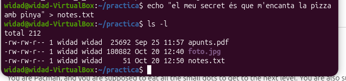
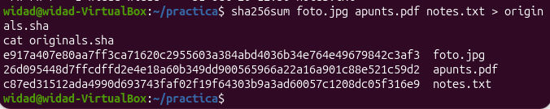
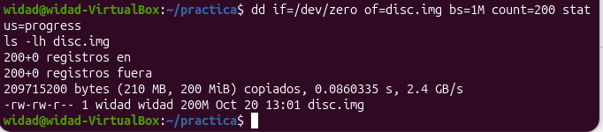
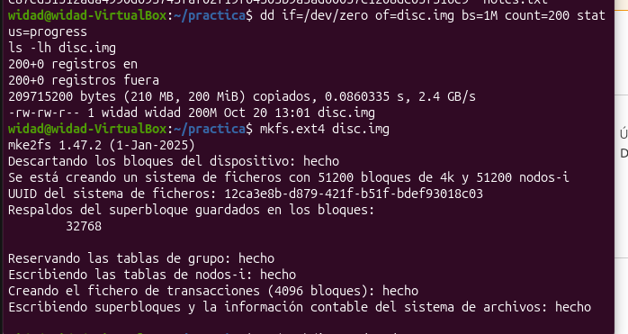
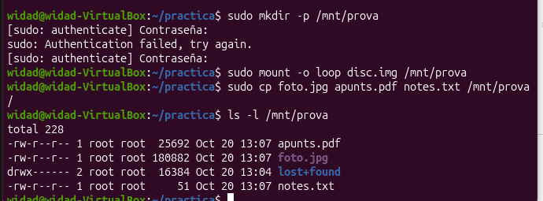

## Particions i sistemes de fitxers

Un disc nou no es pot fer servir directament: primer es **parteix** (es crea la taula
de particions), després es **formata** cada partició (se li posa un sistema de
fitxers) i finalment es **munta** en una carpeta de l'arbre de Linux.

### Conceptes bàsics

- **Disc**: el dispositiu sencer, físic o virtual (`/dev/sda`, `/dev/sdb`...).
- **Taula de particions**: l'índex al principi del disc que diu on comença i on
  acaba cada partició (MBR o GPT).
- **Partició**: un tros continu del disc que el sistema tracta com un disc
  independent (`/dev/sdb1`).
- **Sistema de fitxers**: l'estructura que es posa a la partició en formatar-la
  perquè s'hi puguin guardar fitxers i carpetes (ext4, NTFS, FAT32...).
- **Sector**: la unitat física més petita que el disc pot llegir o escriure (512
  bytes tradicionalment, 4096 bytes als discos moderns).
- **Bloc**: la unitat amb què treballa el sistema de fitxers, un grup de sectors
  consecutius (normalment 4096 bytes a ext4). Un fitxer sempre ocupa blocs sencers,
  encara que no els ompli del tot — l'espai que es perd es diu **fragmentació
  interna**.
- **Punt de muntatge**: la carpeta de l'arbre de Linux on s'entra al contingut
  d'una partició (`/var/particio1`). A Linux no hi ha lletres com `C:` o `D:`.

### Pla: l'exercici del disc del servidor de l'acadèmia

L'exercici consisteix a afegir un disc nou de 3 GB a la màquina virtual d'Ubuntu i
crear-hi una taula GPT amb quatre particions:

| Partició | Mida | Sistema | Bloc | Etiqueta | Punt de muntatge |
|---|---|---|---|---|---|
| sdc1 | 1 GiB | ext4 | 4096 | projectes | /srv/projectes |
| sdc2 | 1 GiB | ext4 | 1024 | petits | /srv/petits |
| sdc3 | 512 MiB | FAT32 | per defecte | INTERCANVI | /mnt/intercanvi |
| sdc4 | la resta | swap | — | swapextra | (cap, la swap no en té) |

Passos:

1. Fer una instantània de la VM d'Ubuntu i afegir un disc nou de 3 GB al
   controlador SATA.
2. Anotar la mida del disc en bytes i en sectors, i la mida de sector lògic i
   físic, amb `lsblk -o NAME,SIZE,LOG-SEC,PHY-SEC /dev/sdc` i `sudo fdisk -l
   /dev/sdc`.
3. Crear la taula GPT amb `sudo fdisk /dev/sdc` i les quatre particions de la
   taula.
4. Formatar cada partició amb el sistema i la mida de bloc indicats, i activar la
   swap.
5. Muntar-ho tot de forma permanent amb `/etc/fstab` (UUID i `nofail`), reiniciar
   i comprovar-ho.
6. Experiment de fragmentació interna: crear 1000 fitxers de 100 bytes a
   `/srv/projectes` i a `/srv/petits`, i comparar amb `du` l'espai real ocupat a
   cada partició.

Cal lliurar:

- Captura de `lsblk -o NAME,SIZE,LOG-SEC,PHY-SEC /dev/sdc` i de `sudo fdisk -l
  /dev/sdc`.
- Captura de `lsblk -f /dev/sdc` i de `cat /etc/fstab`.
- Captura de `df -hT` i `swapon --show` fetes després de reiniciar.
- Captura de les dues ordres `du` de l'experiment de fragmentació.
- Respostes a les sis preguntes de l'exercici, amb la taula de fragmentació
  plena.

## Recuperació de fitxers després d'un formateig

Pràctica independent per comprovar que formatar un disc no esborra els fitxers
de seguida: només esborra l'índex que diu on és cadascun.

### Preparació: tres fitxers de prova

Vaig crear la carpeta `~/practica` i hi vaig posar tres fitxers: una foto i un PDF
copiats amb l'aplicació Fitxers, i un text creat directament des del terminal amb
`echo`:
```
echo "El meu secret és que m'encanta la pizza amb pinya" > notes.txt
```



Després en vaig calcular el hash amb `sha256sum`, per poder comprovar més endavant
que els fitxers recuperats són exactament els mateixos:
```
sha256sum foto.jpg apunts.pdf notes.txt > originals.sha
cat originals.sha
```



### Creació del disc virtual

Vaig crear un fitxer de 200 MB ple de zeros, que fa de disc durant tota la
pràctica:
```
dd if=/dev/zero of=disc.img bs=1M count=200 status=progress
ls -lh disc.img
```



### Formatar, muntar i copiar-hi els fitxers

Vaig formatar el disc virtual amb ext4:
```
mkfs.ext4 disc.img
```



Després el vaig muntar i hi vaig copiar els tres fitxers:
```
sudo mkdir -p /mnt/prova
sudo mount -o loop disc.img /mnt/prova
sudo cp foto.jpg apunts.pdf notes.txt /mnt/prova/
ls -l /mnt/prova
```



Pla per a la resta de la pràctica:

1. Desmuntar el disc i tornar-lo a formatar (formateig d'alt nivell), i
   comprovar que el contingut sembla haver desaparegut (només queda
   `lost+found`).
2. Recuperar els fitxers amb `photorec` sense necessitar l'índex esborrat, i
   comprovar amb `sha256sum` que els fitxers recuperats són idèntics als
   originals, byte a byte.
3. Buscar el text de `notes.txt` directament dins del disc amb `strings | grep`,
   ja que `photorec` no reconeix fitxers de text sense capçalera.
4. Omplir tot el disc de zeros (formateig de baix nivell) i tornar a provar
   `photorec` i la cerca de text: aquesta vegada no ha de trobar res.

Cal lliurar:

- Captura dels hashes dels tres fitxers originals.
- Captura del disc amb només `lost+found` després del formateig.
- Captura dels hashes dels fitxers recuperats i dels originals, iguals.
- Captura de la frase trobada dins del disc.
- Captura de `photorec` sense cap fitxer i de `grep` sense resultat, després
  d'omplir el disc de zeros.
- Respostes a les sis preguntes de la pràctica.
