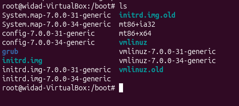
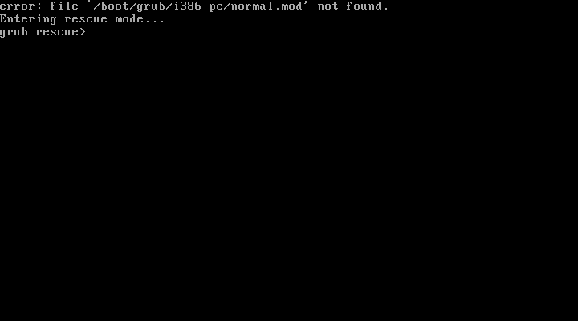
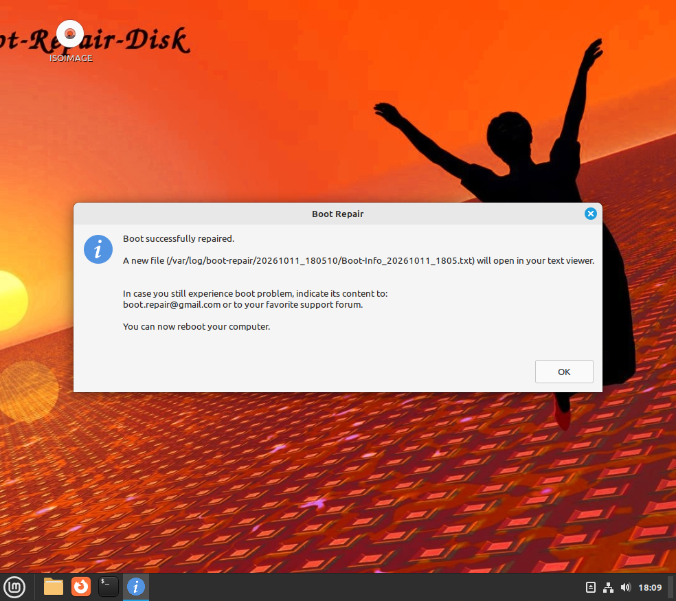
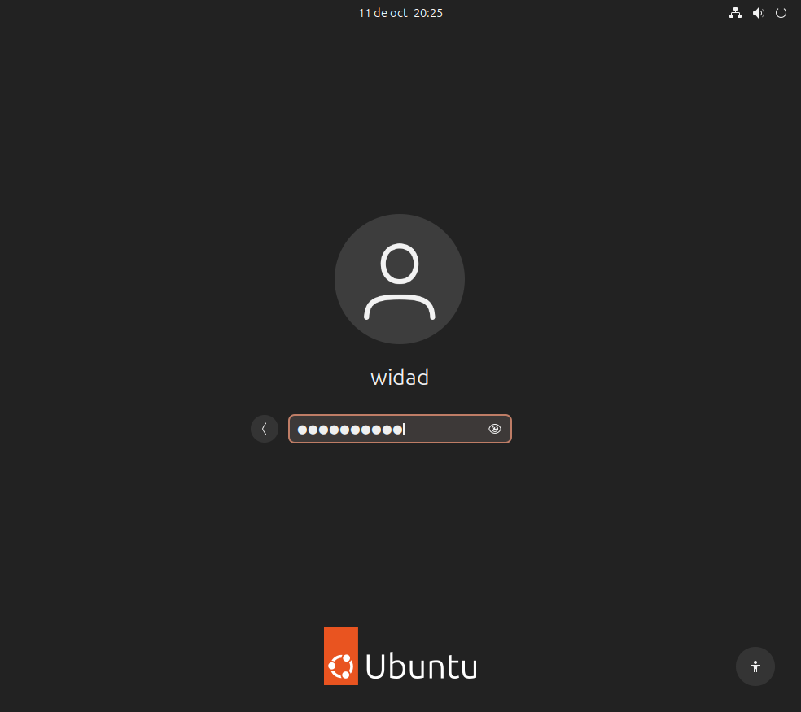

## Tallafocs i control d'accés

Un **tallafocs** ben configurat només obre els ports que realment es
fan servir.

- Consultar les regles actives.
- Obrir només els ports necessaris.
- Bloquejar la resta de trànsit entrant.

## Còpies de seguretat

Una política de **còpies de seguretat** periòdiques evita perdre
informació important.


## Monitorització del sistema

Monitoritzar l'ús de **CPU, memòria i disc** ajuda a detectar
problemes abans que afectin el servei.

- Revisar l'ús de recursos amb eines del sistema.
- Configurar alertes davant valors anormals.

## Gestor d'arrencada (GRUB2)

El **gestor d'arrencada** és el programa que permet que l'ordinador
engegui el sistema operatiu. El més utilitzat a Ubuntu és **GRUB2**,
que deixa triar entre diferents sistemes si n'hi ha més d'un
instal·lat. Per organitzar l'espai del disc dur hi ha dues opcions:
**MBR** (antic, només funciona amb discos de fins a 2 TB) i **GPT**
(més modern, admet discos més grans i és més segur). Si en arrencar
apareix l'error **"Gestor d'arrencada pendent"** (o *grub rescue*),
vol dir que el sistema no sap com arrencar; es pot solucionar
reinstal·lant el gestor amb un USB o una imatge ISO.

> ⚠️ **Abans de començar**: aquest exercici trenca el gestor
> d'arrencada expressament per després reparar-lo. Fes-ho només en una
> **màquina virtual** i, si pots, crea abans una instantània (snapshot)
> per poder tornar enrere si alguna cosa surt malament.

Hi ha dues eines habituals per reparar GRUB2 quan es trenca: **Super
Grub2 Disk** (deixa arrencar el sistema de forma temporal encara que
GRUB estigui trencat, per després reinstal·lar-lo tu mateix) i
**Boot-Repair** (repara el gestor de manera automàtica, sense haver
d'escriure comandaments).

### Mètode 1 · Súper Grub2 Disk

1. Entra com a administrador a la carpeta `/boot` des del terminal. Amb
   `ls` es veu que hi ha la carpeta `grub` (en blau), al costat dels
   nuclis de Linux (`vmlinuz-7.0.0-...`) i de les imatges `initrd`:
   ```
   sudo su
   cd /boot
   ls
   ```

   

2. Esborra la subcarpeta `grub/`. Aquest pas trenca el gestor
   d'arrencada expressament:
   ```
   rm -r grub/
   ```

   

   Si tornes a fer `ls`, veuràs que la carpeta `grub` ja no hi és. Els
   nuclis i les imatges `initrd` continuen al seu lloc; només falta el
   programa que els carrega:

   

3. Reinicia la màquina. Com que GRUB no troba els seus arxius, surt
   l'error `file '/boot/grub/i386-pc/normal.mod' not found` i el
   sistema entra en **mode rescat** (`grub rescue>`), sense poder
   arrencar Ubuntu:

   

4. Apaga la màquina virtual, obre **Configuració → Emmagatzematge** i
   afegeix la imatge ISO de **Super Grub2 Disk**
   (`super_grub2_disk_hybrid_2.02s3.iso`) al lector òptic del
   controlador **IDE**.

   

   > 💡 La BIOS de VirtualBox només arrenca del CD que hi ha al
   > controlador **IDE**. Si hi tens la ISO de les *Guest Additions*,
   > canvia-la per la de Super Grub2 o la màquina tornarà a arrencar
   > del disc dur i al `grub rescue`.

5. Arrenca la màquina amb la ISO muntada. Al menú de Super Grub2,
   selecciona **"Detect and show boot methods"**. Després tria el
   nucli de Linux que apareix a la llista (per exemple
   `/vmlinuz-7.0.0-...-generic`) i prem **Enter** per iniciar Ubuntu de
   forma temporal.

6. Ja dins d'Ubuntu, obre un terminal, converteix-te en superusuari i
   reinstal·la GRUB definitivament:
   ```
   sudo su
   grub-install /dev/sda
   update-grub2
   apt-get install grub2
   ```
   - `grub-install /dev/sda` torna a escriure el gestor d'arrencada al
     disc principal i recrea la carpeta `/boot/grub`.
   - `update-grub2` busca els nuclis instal·lats i genera el menú
     d'arrencada (`grub.cfg`).
   - `apt-get install grub2` assegura que el paquet de GRUB està
     instal·lat correctament.

7. Apaga la màquina, treu la ISO del lector i torna-la a engegar:
   l'ordinador hauria d'arrencar de manera normal, amb GRUB ja reparat.

### Mètode 2 · Boot-Repair

1. Repeteix el trencament: `cd /boot` i `sudo rm -r grub/`. En reiniciar
   torna a sortir el missatge `grub rescue`:
   ```
   cd /boot
   sudo rm -r grub/
   ```

   

2. Apaga la màquina virtual i, aquesta vegada, posa la imatge ISO de
   **Boot-Repair** (`boot-repair-disk-64bit.iso`) al lector òptic del
   controlador IDE, en lloc de la de Super Grub2.

3. Arrenca amb la ISO. Boot-Repair-Disk carrega un escriptori en mode
   *live* i obre automàticament el programa **Boot Repair**, que
   analitza el disc. A la finestra principal, tria **"Recommended
   repair"** (reparació recomanada), que sol ser suficient per
   resoldre els problemes més habituals de GRUB:

   

4. Durant el procés, Boot-Repair pregunta si vols pujar l'informe a
   internet (*"Upload the report to a pastebin?"*). No és necessari:
   es pot respondre **No** i l'informe es desa igualment dins de la
   màquina, a `/var/log/boot-repair/`.

   

5. En acabar apareix el missatge **"Boot successfully repaired"**, que
   confirma que GRUB s'ha reinstal·lat:

   

6. Apaga la màquina, treu la ISO de Boot-Repair de la configuració i
   torna-la a engegar. El sistema ja no s'atura a `grub rescue`:
   arrenca Ubuntu amb normalitat i arriba a la pantalla d'inici de
   sessió.

   

**Diferència clau entre els dos mètodes**: amb Super Grub2 Disk
arrenques de manera temporal i després reinstal·les GRUB tu mateix
amb comandaments (`grub-install`, `update-grub2`); amb Boot-Repair
tot el procés de reparació és automàtic i només cal prémer un botó.
