## Enunciat i objectius d'aquest sprint

Cal crear una màquina virtual per allotjar un Windows i fer-ne la instal·lació completa,
triant les opcions adequades per a un ús general d'ofimàtica. Durant la instal·lació cal
identificar els elements funcionals del sistema (gestor d'arxius, gestor de processos,
sistema de permisos, registre de Windows) i tenir en compte els tipus de llicència
(OEM, Retail, Volum, Educacional), indicant quina s'fa servir en el projecte i per què.

Un cop instal·lat, cal configurar la xarxa (DHCP, IP estàtica, DNS, grup de treball) i
comprovar-ne el funcionament amb `ping` i `ipconfig`; instal·lar programari bàsic de
seguretat i utilitats (antivirus, tallafocs, eines d'actualització, compressió, navegador
alternatiu); i simular una incidència d'arrencada (boot) resolent-la amb les eines de
recuperació de Windows (WinRE, `bootrec`, `bcdedit`).

**Objectius:**

- Identificar els elements funcionals d'un sistema operatiu.
- Fer la instal·lació i configuració inicial d'un Windows.
- Configurar i verificar els serveis i protocols de xarxa.
- Utilitzar màquines virtuals per a tota la configuració.

## 1. Màquina virtual, instal·lació i particions

Una màquina virtual és un ordinador simulat que funciona dins del teu: tu decideixes
quanta memòria, quant disc i quina xarxa té, i el que hi facis no afecta l'equip real.
Hi vaig instal·lar Windows 11 a partir d'una imatge ISO, repartint el disc en particions
(unitats separades que el sistema veu de manera independent).

### Creació de la màquina virtual

Vaig crear a VirtualBox una màquina anomenada **Windows11widad**, amb **2 processadors**,
**4942 MB de RAM** (uns 4,8 GB) i un disc dur virtual de mida dinàmica de **50,67 GB**.
Com que és Windows 11, vaig activar l'opció **Enable EFI** ja durant l'assistent de
creació.

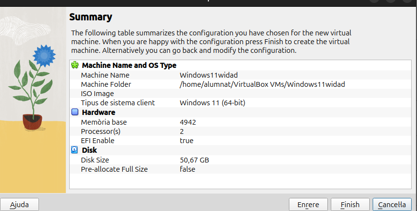

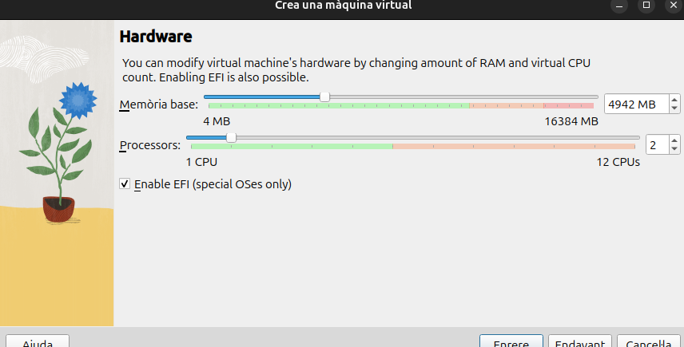

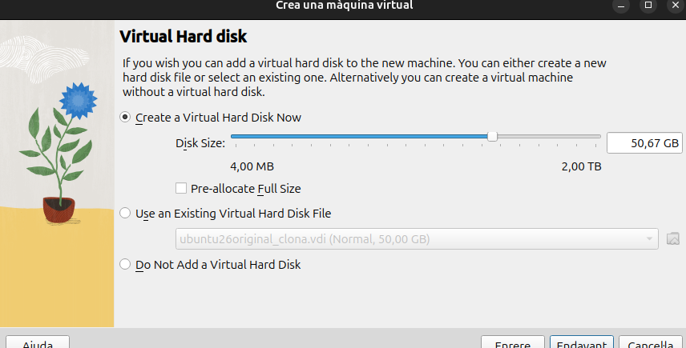

Un cop creada, vaig anar a **Configuració → Sistema → Placa mare** i vaig confirmar que
hi havia **TPM v2.0**, **Activa EFI** i **Enable Secure Boot** marcats: Windows 11 (a
diferència de Windows 10) exigeix aquests tres requisits, i si no estan actius
l'instal·lador es queda aturat dient que l'equip no compleix els requisits mínims.

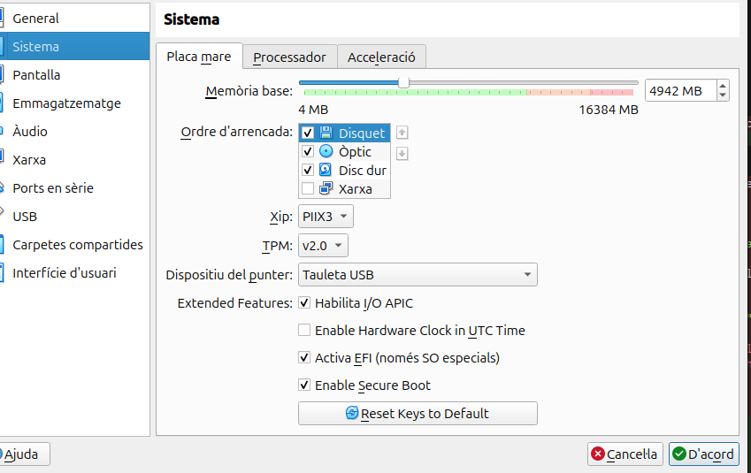

### Primeres passes de l'instal·lador

Vaig muntar la ISO de Windows 11 i vaig engegar la màquina. El primer pas de l'assistent
va ser triar l'idioma i el format d'hora i moneda (Español, España, internacional):

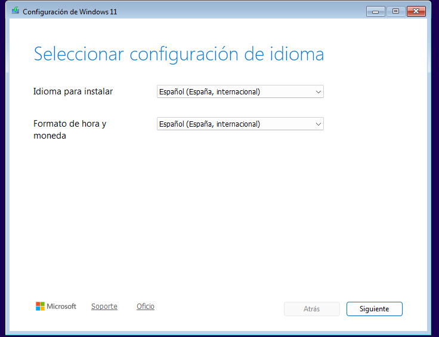

### Incidència trobada: el disc no complia els requisits mínims

En arribar a la pantalla de particions, amb els 50,7 GB sense assignar seleccionats,
l'instal·lador em va mostrar l'avís **"Windows 11 no se puede instalar en esta
unidad"**, sense deixar continuar:

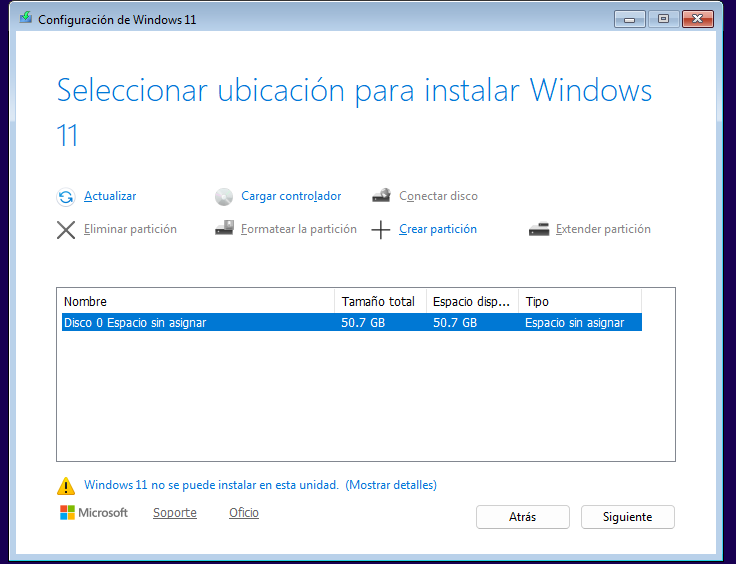

Per investigar-ho, vaig obrir una línia d'ordres dins del mateix instal·lador (**Mayús +
F10**) i vaig comprovar amb `diskpart` la mida real del disc:
```
diskpart
list disk
```

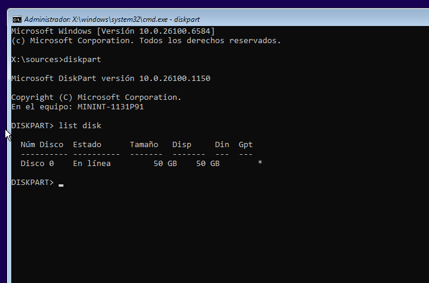

El disc era efectivament de 50 GB. Vaig tornar a l'assistent gràfic i vaig clicar
**"Mostrar detalles"** sota l'avís, i allà vaig trobar el motiu exacte:

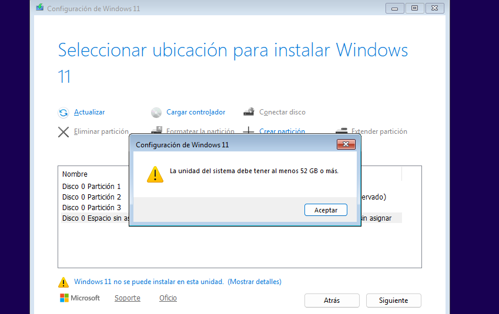

**"La unidad del sistema debe tener al menos 52 GB o más."** És a dir: tot i que la guia
de la pràctica demanava un disc de 50 GB, aquesta ISO en concret de Windows 11 necessita
com a mínim 52 GB per poder-hi instal·lar el sistema.

### Resolució de la incidència

Vaig apagar la màquina virtual completament i, des d'un terminal del meu Linux (fora de
la VM), vaig localitzar el fitxer de disc i l'vaig ampliar a 64 GB per tenir marge:
```
VBoxManage list hdds
VBoxManage modifymedium disk "/home/alumnat/VirtualBox VMs/Windows11widad/Windows11widad.vdi" --resize 65536
```

Vaig tornar a engegar la màquina, vaig entrar una altra vegada per `diskpart` i vaig
netejar el disc perquè l'instal·lador reconstruís la taula de particions amb la mida
nova:
```
diskpart
select disk 0
clean
convert gpt
exit
exit
```

Després de clicar **Actualizar**, l'espai sense assignar ja mostrava **64 GB** i l'avís
d'error havia desaparegut:

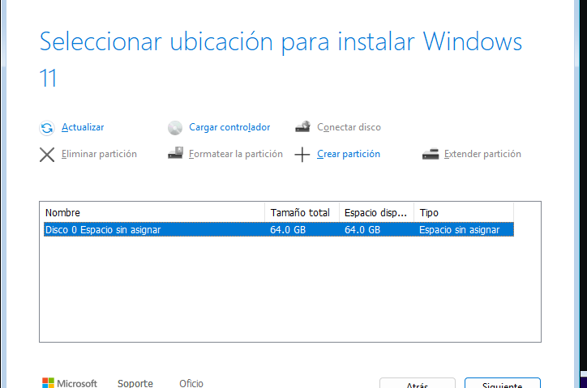

### Creació de la partició de Windows

Amb l'espai sense assignar seleccionat, vaig clicar **Crear partición** i hi vaig
escriure **30000** (MB) per deixar-ne la resta lliure per a una futura unitat `D:`. Al
primer intent se'm va quedar massa petita (uns 2,9 GB, per un error en teclejar la
mida), així que vaig esborrar aquella partició i la vaig tornar a crear, aquesta vegada
comprovant bé el número abans de confirmar. El resultat final va ser:

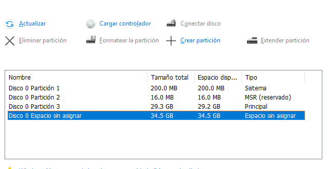

- **Partició 1 — Sistema**: 200 MB (creada automàticament per a l'arrencada EFI)
- **Partició 2 — MSR (reservado)**: 16 MB (reservada pel sistema)
- **Partició 3 — Principal**: 29,3 GB, on es va instal·lar Windows
- **Espai sense assignar**: 34,5 GB, reservats per crear-hi una unitat de dades més endavant

Vaig seleccionar la Partició 3 i vaig prémer **Siguiente** per començar la instal·lació
de debò. L'assistent va copiar els arxius i es va reiniciar sol unes quantes vegades
fins arribar a la configuració inicial (idioma, país, teclat i compte d'usuari local
**widad**).

### Instal·lació completada

Un cop acabada la configuració inicial, Windows 11 ja arrenca normal amb la pantalla
d'inici de sessió de l'usuari **widad**:

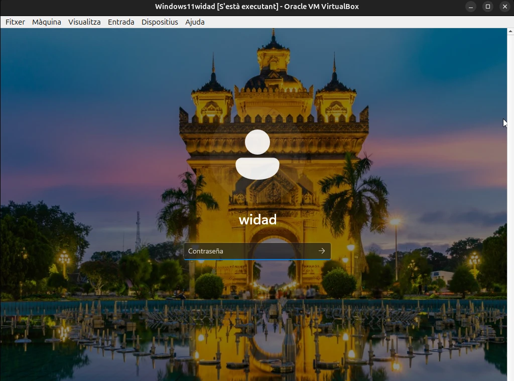

I, en entrar-hi, l'escriptori i el menú Inici ja funcionen amb normalitat (es veu a la
cantonada inferior dreta que és l'edició **Windows 11 Enterprise Evaluation**):

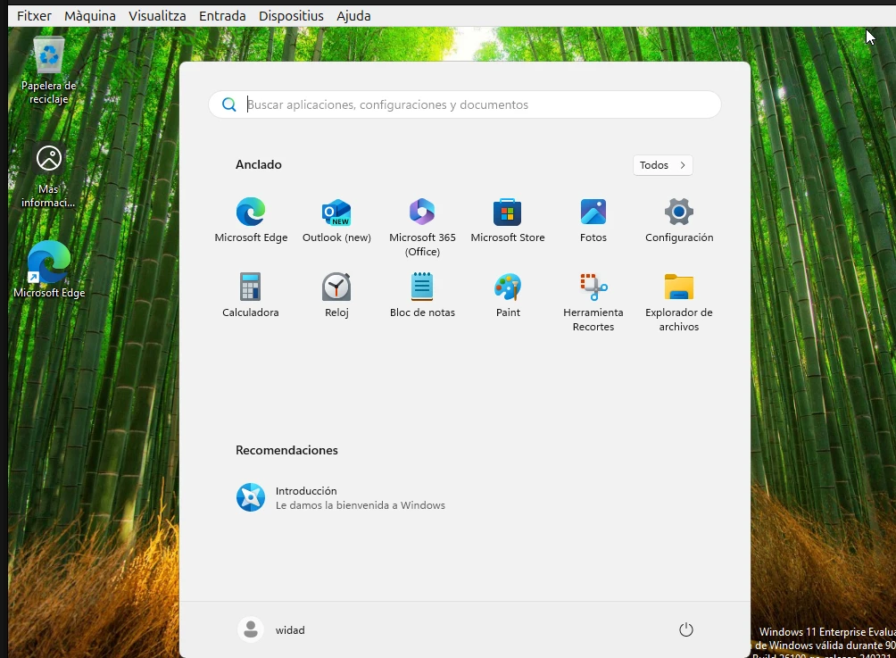

### Creació de la unitat de dades

Per acabar, vaig obrir `diskmgmt.msc` per convertir els 34,5 GB sense assignar en una
segona unitat. Com que les lletres **D:** i **E:** ja estaven ocupades per les dues
unitats òptiques virtuals (una buida i una altra amb la ISO de Windows muntada), vaig
deixar que l'assistent assignés la primera lletra lliure, que va ser la **F:**, amb
sistema de fitxers **NTFS** i el nom de volum **DADES**:

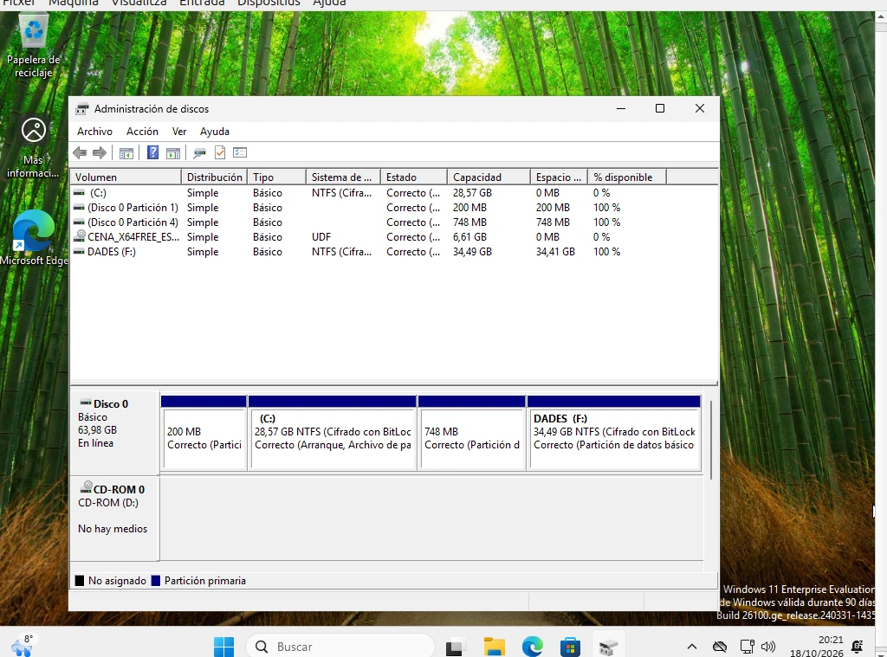

Amb això la part 1 del sprint (màquina virtual, instal·lació i particions) ja està
completa.

## 2. Llicències

Windows no és gratuït: per fer-lo servir legalment cal una llicència activada. N'hi ha de
diferents tipus: **Retail** (es compra a part i es pot passar a un altre equip), **OEM**
(ve amb l'ordinador i hi queda lligada) i **de volum** (per a empreses i centres). Als
servidors, a més, hi ha les **CAL**.

Vaig anar a **Configuración → Sistema → Activación** per veure l'edició instal·lada i
l'estat d'activació: **Windows 11 Enterprise Evaluation**, amb l'estat **Activo**.

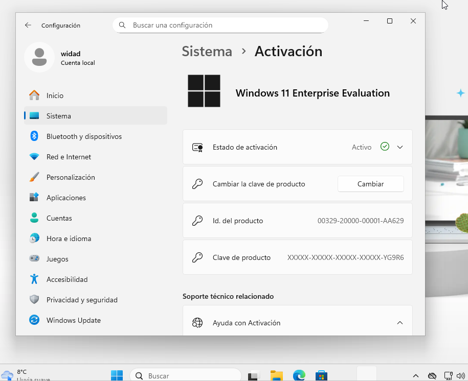

Des del `cmd`, vaig comprovar-ho també per comandes. Amb `slmgr /xpr` es veu quan caduca
l'activació temporal (16/01/2027):

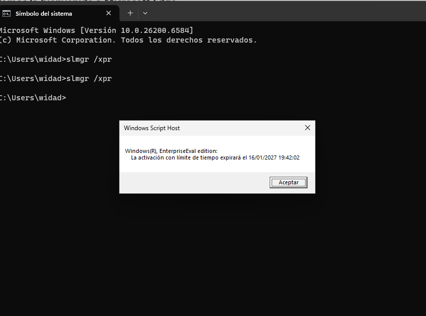

I amb `slmgr /dli` es veu el tipus de llicència concret: canal **TIMEBASED_EVAL**, amb
129408 minuts (90 dies) fins que caduca:

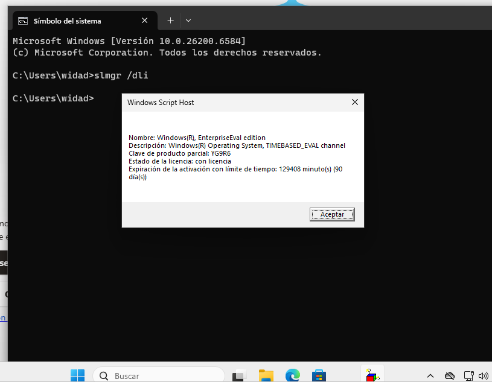

Després vaig buscar els preus de Windows 11 a la botiga oficial de Microsoft:
**Windows 11 Home** val 145,00 €...

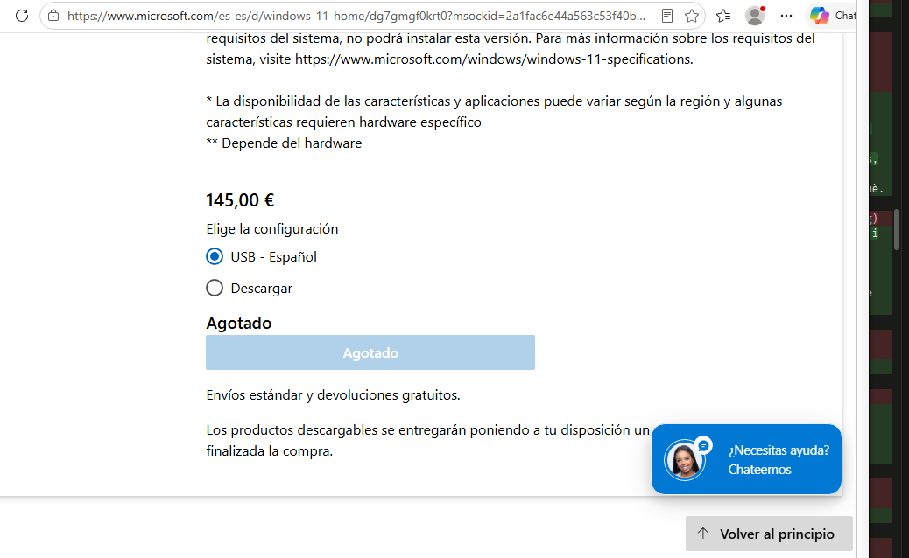

...i **Windows 11 Pro** val 259,00 €:

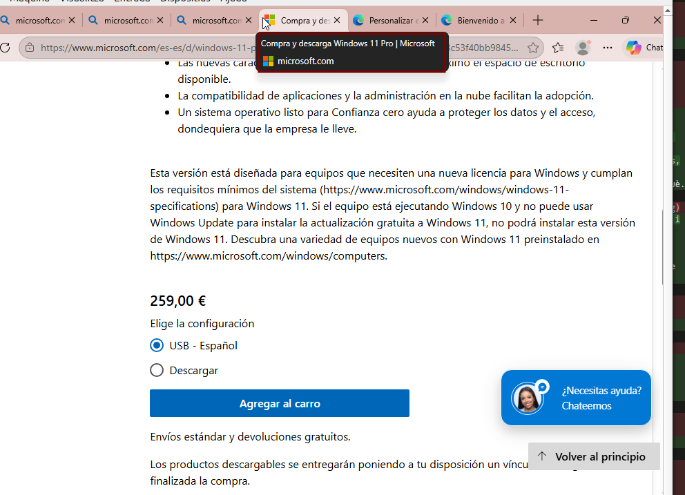

A una altra botiga (Softlite) vaig trobar Windows 11 Pro dins d'un paquet combinat amb
Office 2024 i Illustrator per 35,00 € en oferta (preu normal 54,00 €) — molt més barat
que a Microsoft, però perquè va inclòs amb altre programari, no és Windows 11 Pro sol:

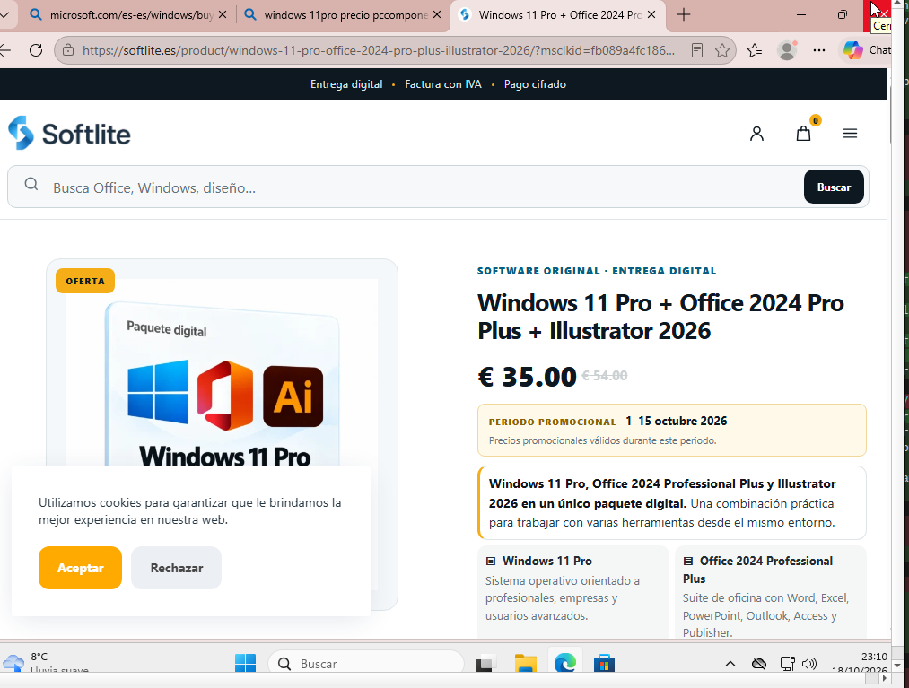

Finalment vaig buscar què és una **CAL** a la pàgina oficial de llicenciament de
Microsoft: és una llicència d'accés de client, no un programa en si, que dona dret a
un usuari o dispositiu a connectar-se als serveis d'un servidor de la xarxa (per
exemple, per compartir arxius o impressores).


## 3. Comandes bàsiques

La línia de comandes permet donar ordres a l'ordinador escrivint, sense finestres ni
ratolí. És més ràpida per a moltes tasques i és l'eina habitual per administrar sistemes.
Ho vaig fer tot des del **Símbol del sistema (cmd)**.

Primer vaig entrar a l'Escriptori i vaig crear una carpeta de proves:
```
cd Desktop
mkdir practica
cd practica
```

Dins seu vaig crear un fitxer de text amb `echo` i vaig comprovar amb `dir` que s'havia
creat (al primer intent vaig oblidar-me el `> nota.txt` i no es va crear res; repetint-ho
bé ja va sortir el fitxer amb 7 bytes):

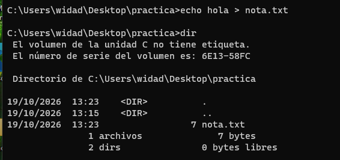

Després en vaig fer una còpia amb `copy` i vaig tornar a comprovar-ho amb `dir`:

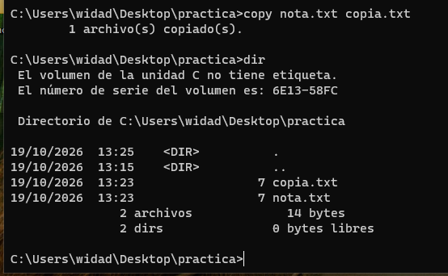

A continuació vaig crear una carpeta `arxiu`, hi vaig moure la còpia, i vaig canviar el
nom tant del fitxer com de la carpeta:
```
mkdir arxiu
move copia.txt arxiu
ren nota.txt notes.txt
ren arxiu backup
```

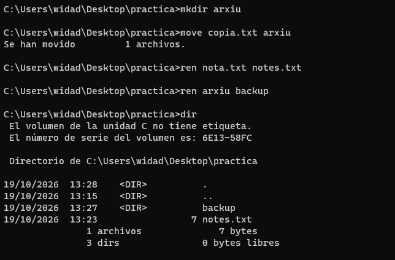

Vaig entrar a la carpeta `backup` per comprovar que hi havia la còpia:

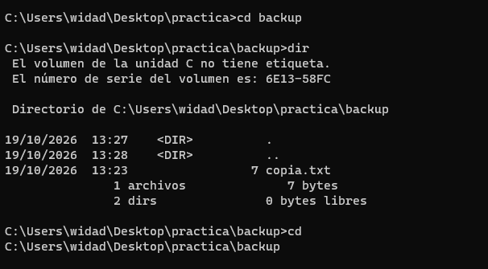

Després de sortir amb `cd ..`, vaig mostrar tota l'estructura de carpetes i fitxers amb
`tree /f`: només queda `notes.txt` a l'arrel i `copia.txt` dins de `backup`.

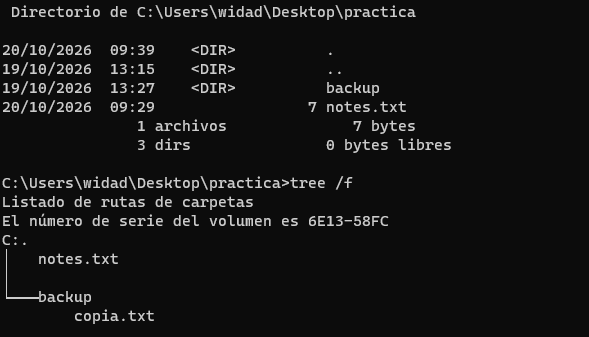

Finalment vaig esborrar `notes.txt` amb `del` i vaig comprovar amb `dir` que ja no hi
era (només queda la carpeta `backup`), i vaig netejar la pantalla amb `cls`:

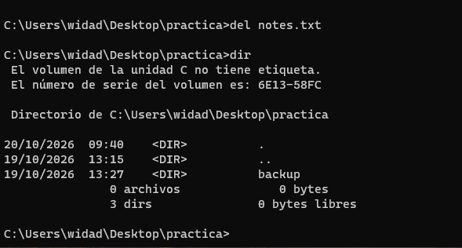

## 4. Aplicacions i punts de restauració

Un punt de restauració és una còpia de l'estat del sistema (programes, configuració i
registre) en un moment concret. Si després d'instal·lar alguna cosa el sistema falla, es
pot tornar a aquell punt; els documents personals no s'esborren. Ho vaig provar
instal·lant Google Chrome.

Primer vaig activar la protecció del sistema al disc `C:` (la unitat `DADES (F:)` la
vaig deixar desactivada, ja que no cal protegir-la):

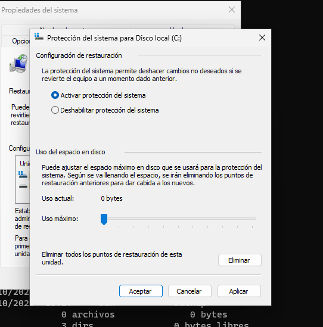

Després vaig crear un punt de restauració amb el nom **"Abans de chrome"**:

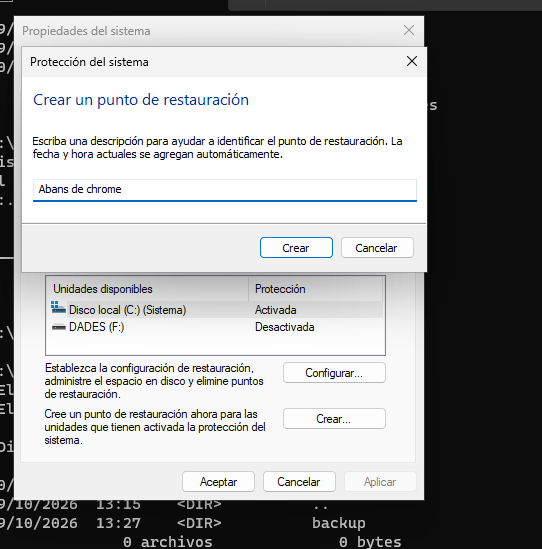

Encara em falta descarregar i instal·lar Chrome, comprovar que la restauració el
detecta com a programa afectat, i restaurar el sistema per comprovar que desapareix.

## 5. Xarxa

Per tenir Internet, l'equip necessita una adreça IP, una connexió activa i un servidor
DNS, que tradueix noms com `google.com` a adreces IP. Fent `ping` a un nom i a una IP es
pot saber si hi ha connexió i on falla. El pla és canviar l'adaptador de la màquina
virtual per veure què passa en cada cas:

- Amb l'adaptador en NAT, executar `ipconfig`, `ping google.com` i `ping 8.8.8.8`.
- Desconnectar el cable virtual de xarxa i repetir els dos `ping`.
- Tornar a connectar el cable i canviar l'adaptador a mode pont, repetint `ipconfig` i
  els dos `ping`.
- Posar un DNS manual (1.2.3.4) i repetir els dos `ping`, i després tornar el DNS a
  automàtic.
